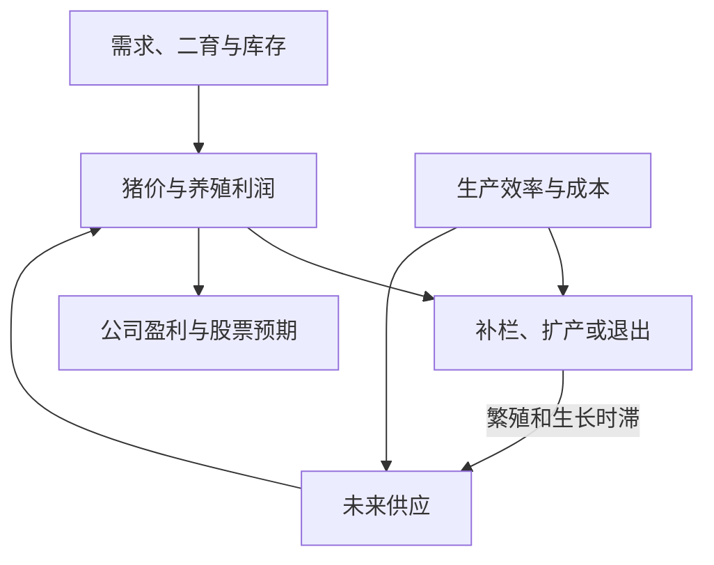

# 叙述结构参考材料

本文件只用于教学结构与转场参考，不作为本轮价格、会计或估值计算的事实证据。

# 猪周期参考视频：叙述逻辑分析与深度版升级建议

> 分析对象：《普通投资者猪周期入门学习手册》™B站版，BV17Lnt6bE6U，用户上传版本。  
> 视频时长：约37分36秒。  
> 整理日期：2026年10月24日。  
> 文档用途：为后续40—60分钟猪周期深度分析视频提供结构参考。

## 一、核心判断

这条视频采用的是“从一头猪的生产，讲到猪场经营，再讲到行业周期和投资预期”的路线。其核心任务，是为普通投资者建立理解猪企所需的产业知识，并为后续公司分析做准备。

全片的教学方式可以概括为：**先解释各个组成部分，再汇总猪周期的运行机制。**生物学、经营模式、成本、现金流、价格传导和市场预期，分别承担不同的解释任务。

原片的优势是知识覆盖广、具体对象明确、善于用反问引出下一段，同时多次提醒观众核对统计口径和推断条件。其主要深化空间在于：**已识别的变量尚未充分组成一套从成本、产能、有效供给到猪价与企业价值的统一数量分析。**

因此，新视频的重点应是让每一章交付一个后续章节能够继续使用的结果，把知识组织成可以追溯、计算、更新和检验的论证链。[V1：全片]

### 分析范围与阅读说明

- 本文依据上传视频的口播转写、画面字幕和讲解页，分析内容组织、论证衔接与表达方式。
- 下文时间为便于回看的约略定位；章节按照论证功能重新划分，并非原作者正式发布的章节目录。
- 视频中的行业数据、公司财务与交易规则没有在本轮逐项进行外部事实核验；引用时仅用于说明原片的论证方式。
- 对新视频的结构建议，不代表已经完成猪价预测或企业估值。

## 二、原片的完整叙述顺序

| 约略时间 | 主要内容 | 叙述功能 |
| --- | --- | --- |
| 00:00—02:40 | 投资争议、不同阶段猪价与养殖盈亏的反差；提出“刚需商品为何价格波动如此大”；预告后续公司分析 | 制造问题与观看动机，说明理解行业对研究公司有何用途 |
| 02:40—08:05 | 猪的品种、杂交、繁殖、保育与育肥；料肉比、PSY、MSY和成活率 | 建立供给调整的物理约束，并说明母猪数量与最终商品猪数量之间仍有转换过程 |
| 08:05—14:45 | 牧原与温氏的经营模式；资本开支、折旧、代养费；规模场与散户差异；现货销售、套保与退出 | 解释不同经营者在同样猪价下，为何有不同成本、现金压力和承受能力 |
| 14:45—18:05 | 非洲猪瘟、生物安全、同场与分场、全进全出、饲料、地域布局及自动化 | 展示养殖的现实约束，解释生产管理如何影响成本、效率与供应稳定性 |
| 18:05—22:25 | 完全成本、现金成本、成本构成、自繁自养与外购育肥、单头盈亏、存货减值 | 建立养殖经营账本，解释亏损后仍可能继续生产，以及养殖与报表利润的区别 |
| 22:25—27:55 | 再次回顾生长时滞；能繁母猪指标；活猪、白条和零售价；仔猪价、二育、冻品、进口及当下现象 | 将生产过程接到市场供应，解释供应如何被延后、调整与分配 |
| 27:55—31:00 | 完整周期反馈过程；历史周期、疫病冲击、规模化、能繁与效率变化 | 汇总价格、生产决策、供给时滞之间的反馈关系，并讨论每轮周期为何不同 |
| 31:00—32:45 | 生猪期货单位、合约月份、套保手数、近远月价格及预期 | 提供理解风险管理和市场预期的工具 |
| 32:45—36:00 | 行业集中度；牧原、温氏、新希望、东瑞、天邦的差异；月度销售简报 | 从共同的行业周期转向不同公司的经营和生存差异 |
| 36:00—37:36 | 股票提前交易预期；市场已计入多少改善；再次补充PSY；预告下一期 | 收束投资层面的认识，并为后续公司研究建立入口 |

两个关键节点值得保留：

1. 约18分钟，原片集中回答“养一头猪究竟赚多少钱”。
2. 约28分钟，原片集中展示“涨价—扩产—滞后增供—跌价—去化—供给收缩”的完整反馈过程。

此前已经在逐步铺设周期的组成部分。因此，“完整模型集中出现较晚”属于叙事节奏评价，不意味着前面没有讲周期，也不意味着铺垫无关。[V1：17:53—18:23；27:52—28:50]

## 三、贯穿全片的四层论证逻辑

### 3.1 从价格反差，进入生物学时间约束

开头先展示不同阶段的猪价与单头盈亏反差，再以可乐作对照，提出一个观众容易理解的问题：一个长期有人消费、规模很大的商品，为什么价格仍会剧烈波动？

随后讲妊娠、哺乳、保育和育肥，实际是在为“供应为什么不能迅速调整”准备解释。

这一层的逻辑是：

**需求长期存在 → 供给仍可能与需求错位 → 生猪生产受到繁殖和生长时间约束。**

它让观众先理解时间约束，再理解价格周期，避免一上来就把“几年一轮”作为不加解释的规律。[V1：00:32—04:13]

### 3.2 从经营差异，进入扩产和退出决策

生物学时滞解释了调整速度，经营模式、成本和现金流则解释经营者为什么会采取不同的行动。

前半片最有解释力的转折之一，是约14分16秒的反问：投资者相信未来会回暖，养殖者难道看不到吗？作者随后强调，即便看得到，也必须能够承受等到猪价上涨之前的现金压力。

这一层的逻辑是：

**效率与经营方式不同 → 成本及现金压力不同 → 亏损承受能力不同 → 减栏、淘汰、退出或继续生产。**

其价值在于把产能变化放回真实经营决策，解释为何“预期未来会改善”与“当下仍发生退出”可以同时存在。[V1：08:05—14:48]

### 3.3 从产能变化，进入实际供应与价格传导

能繁、仔猪、商品猪、猪肉产量和终端销售，分属不同阶段。原片随后加入二育、冻品、屠宰和价格口径，解释这些阶段之间的转换。

这里需要观众逐步接受四件事：

1. 母猪变化经过繁殖和生长，才能影响后续商品猪出栏。
2. 商品猪头数仍需结合体重，才能对应肉类供应。
3. 已生产出来的猪和猪肉，可能通过二育或冷冻延后销售。
4. 活猪、白条和零售猪肉对应不同商品、重量口径与成本环节。

因此，一个上游指标发生变化，并不意味着下游供应与价格会立即等比例改变。这部分为后面的完整周期模型增加了现实条件。[V1：22:25—27:55]

### 3.4 从行业变化，进入公司盈利和股票预期

最后，视频把视角由养殖经营者转向投资者。

第一层是公司差异：同样的猪价，对成本、业务组合、渠道、资本负担和债务不同的企业，可能产生不同影响。

第二层是市场预期：投资者不仅观察已发生的利润，也会交易对未来猪价、成本和盈利的判断；市场可能已经计入部分改善。

这一层的作用，是告诉观众理解行业以后怎样继续研究公司。原片在开头和结尾都明确预告后续公司专题，因此本片没有交付完整估值，是其系列定位下的内容安排。[V1：01:43—02:27；32:45—37:36]

### 3.5 按因果关系重新整理的简化框架

下图是对原片内容的归纳，不是原作者的正式模型：

这一结构揭示了全片各类知识的共同用途：解释价格如何影响生产决策，以及生产决策如何经过时滞重新影响市场。

## 四、值得借鉴的叙述方法

### 4.1 用自然疑问推动章节

原片较有效的段落，往往从观众自然会产生的问题进入：

- 猪更重，为什么不一定更划算？
- 价格不确定，企业为什么不全部套保？
- 知道未来可能涨价，为什么还会退出？
- 账面已经亏损，为什么仍继续养殖？
- 猪还没卖，为什么已经影响财报利润？
- 母猪减少，为什么出栏仍可能增加？

这些问题让下一段知识有明确用途。新视频可以延续这一方法，让每章结尾留下一个需要下一章继续回答的问题。

### 4.2 用“一头猪”贯穿多个分析层次

一头猪依次是需要时间长大的动物、持续消耗投入的生产对象、单头成本的核算单位、财报中的存货、屠宰后的商品，以及行业总供给的一部分。

这个具体对象降低了跨层次解释的难度。拟议中的120公斤商品猪模型，可以继续发挥这一优点：从繁殖或采购开始，将成本、损耗、效率与销售放入同一个核算对象。

### 4.3 重复概念时改变用途

| 概念出现的位置 | 当时承担的解释任务 |
| --- | --- |
| 前段讲猪的一生 | 建立生产时间概念 |
| 约22分钟重新回顾 | 解释能繁母猪为何提供未来供给线索 |
| 约28分钟汇总周期 | 解释生产决策与价格错位 |
| 结尾再次提及 | 连接产业变化与投资预期 |

这种回扣具有教学价值。新视频每次重复时，应明确说明前面哪个结论正在被用于下一步推导。[V1：02:40—08:05；22:25—23:20；27:55—28:50；36:25—37:08]

### 4.4 反复澄清指标与推断边界

原片已经区分了全程与育肥阶段料肉比、PSY与MSY、完全成本与现金成本、养殖盈亏与公司净利润、时点存量与累计流量、规模化率与企业集中度。

它也讨论了二育、冻品、进口、需求、成活率、出栏体重和市场预期。冻品部分还明确承认：缺少冷库总量和库存吨数，不能仅从库容率判断全国储存了多少猪肉；不同机构口径不能直接互比。[V1：05:33—06:21；07:07—07:56；18:05—22:25；25:48—27:42；32:45—33:25]

因此，深化时应从已有变量继续量化，而不能把原片概括成只看母猪数量、忽略库存和效率。

## 五、叙述结构的主要改进空间

### 5.1 全局框架集中出现较晚

原片先讲生物学、经营模式、套保、退出、防疫、饲料，再集中讲成本和价格。观众需要暂时记住许多知识，等待后面解释其共同作用。

尤其约12—18分钟，话题连续经过套保、期货代码、退出、疫病、隔离流程、场区组织、全进全出、饲料和自动化。局部内容可以理解，全局问题暂时不够醒目。

**改进方式：开头先给出简化总模型，再逐章解释各个变量。**讲防疫时明确其对应成活率、成本和恢复速度；讲折旧时明确其对应利润、现金流和退出决策。

### 5.2 部分转场采用补充知识点的方式

讲完退出后进入非洲猪瘟，讲完防疫后进入饲料，讲完单头盈亏后补充减值，结尾再补充PSY。内容有必要，但有时没有先说明新内容解决了上一段留下的哪个问题。

**改进方式：转场同时交代因果位置。**例如，从经济性退出转向疫病时，先说明疾病也可能通过成活率和繁殖能力改变有效产能；从能繁数量转向PSY时，先说明还需考虑单位母猪的生产效率，才能推算未来供给。

### 5.3 关键变量较分散，缺少持续更新的总账

PSY、现金流、折旧和成本在多个位置出现。回扣有价值，但观众缺少一张不断更新的表，看到新增信息究竟改变哪一项判断。

**改进方式：每章交付一个下一章可直接使用的结果。**例如成本章给出不同效率经营者的成本区间；产能章解释哪些产能承压；供给章给出净供应变化的情景；价格章推导相应区间及条件。

### 5.4 期货细节分成两处，部分内容暂时分散主线

约12—14分钟的期货内容解释企业为何仍承受周期；约31—32分钟的内容解释如何观察市场预期。两个功能都有价值，但合约代码、单位和手数换算属于相对独立的工具知识。

**改进方式：保留风险管理与预期观察的作用，压缩或后置合约细节。**若新片主要回答猪价和企业价值，可将更多时间分配给供需变化及价格推导。[V1：12:11—14:16；31:00—32:45]

### 5.5 结尾补充事项较多

最后几分钟同时处理公司差异、月度跟踪、股票预期、消费者与养殖者利益差异、时滞、PSY和下期预告，收束任务较多。

**改进方式：结尾集中回到开头的问题。**说明哪些判断已有数据支持，哪些仍依赖假设，哪些新数据出现时需要修改结论。PSY及其增速放缓，可提前放入有效供给分析主段。[V1：35:35—37:36]

### 5.6 旁白、字幕与图表应保持相同证据强度

约12—13分钟套保段，口播通过类比计算提出覆盖率估计；在13:10—13:16附近，配套字幕又提醒实际覆盖率未披露，并说明5%—15%属于口播估计而非披露数据。

这反映出上传版本的画面主动增加了限定，但听觉与视觉传递的判断强度不完全一致。

**改进方式：旁白、字幕和图表共同说明披露事实、条件假设、估计结果与证据缺口。**涉及推算时，把成立条件与结果一起讲清楚，不让观众只听到一个确定数字。[V1：12:37—13:29，尤其13:10—13:16画面字幕]

## 六、原片的深度边界与新视频的定量任务

原片已有料肉比变化对应的饲料节省、售价与成本对应的单头盈亏，以及套保数量换算等局部演示。继续深化的重点，是将局部计算连接成统一的数量分析。

| 原片已经解释的机制 | 深度版需要继续回答的问题 | 适合交付的分析结果 |
| --- | --- | --- |
| 经营者效率和成本不同 | 行业成本如何分布？边际供给由哪类产能维持？ | 统一口径的成本分项表与不同效率情景 |
| 亏损可能引起退出 | 多深、多久的亏损可能对应多大产能收缩？融资和产能承接如何影响过程？ | 亏损压力、退出机制与有效产能变化的分析 |
| 母猪减少影响未来供应 | 效率、成活率、体重和时间结构变化后，未来净少多少肉？ | 有效供给情景与关键参数敏感性 |
| 二育和冻品改变销售时间 | 可能转移多少供应、延后多久？缺少总量数据时如何表达不确定性？ | 跨期供应调整的范围与证据缺口 |
| 供给收缩可能支持猪价 | 不同收缩幅度为何对应不同猪价？需求反应和替代消费怎样进入推导？ | 猪价区间、推导理由与历史校准 |
| 猪价影响企业盈利 | 不同价格路径怎样影响利润、现金流和资本需求？ | 公司经营情景与盈利测算 |
| 股票提前反映预期 | 当前市场已经包含什么预期？研究判断与市场的差异在哪里？ | 估值假设、预期比较与后续验证条件 |

**机制存在，只能说明某个因素可能起作用；要判断结果的数量级，还需要数据、参数与可复现的计算。**

例如，原片已讨论PSY可能抵消母猪去化，也在结尾指出近年增速放缓。新片需要进一步研究其合理增长空间，并展示不同增速、成活率及体重假设下，同一幅度母猪去化分别对应什么样的有效供给变化。[V1：06:21—06:50；30:45—31:05；36:50—37:08]

## 七、建议用于新视频的六步论证路线

本节属于新视频的结构建议，尚未开展新的行情预测和估值计算。

### 第一步：一头120公斤商品猪，为什么需要花这些钱？

从同一核算对象出发，把繁殖或仔猪采购、饲料、人工、防疫、死亡损失、折旧及其他费用放入同一套账。参考已有完整成本披露时，注明年份、生产方式和成本边界，再决定如何调整到统一演示口径。

**本章输出：可解释、可复用的成本构成。**

### 第二步：不同经营者为什么会有不同成本？

让同一套成本模型接受不同料肉比、繁殖效率、成活率、产能利用率和生产方式的参数。把企业案例作为模型应用，并说明其在行业中的代表性与局限。

**本章输出：不同类型产能的成本区间与盈利承压情况。**

### 第三步：亏损怎样变成真实的产能收缩？

把现金压力、债务、融资、淘汰母猪、减少补栏和产能承接联系起来。说明经营主体退出与全国有效产能减少之间，需要经过哪些判断。

**本章输出：产能调整的机制、条件和可能路径。**

### 第四步：母猪变化以后，未来究竟多出或少掉多少肉？

统一处理繁殖效率及其增长空间、成活率、出栏体重、生长时滞、二育与冻品等因素。涉及年度效率指标、月度产能和季度出栏时，应明确时间口径与转换方式。

**本章输出：带有条件和不确定范围的未来供给路径。**

### 第五步：这样的供给变化，为什么对应这样的猪价？

按研究计划，从边际产能成本、历史去化与价格关系、需求弹性等角度展开推导。分别说明每条路径的数据来源、适用条件、估计对象和可能失效的原因。

需要区分价格中枢、某阶段均价与短期高点，避免将不同目标混在同一价格区间中。

不同方法如果共享相同的供给和需求假设，结果一致可以支持相互协调，但不能自动当作三份独立证据。应说明哪些参数共享，哪些证据来源不同。

**本章输出：猪价区间、数量关系、参数敏感性与可检验条件。**

### 第六步：这些猪价路径，对公司和投资判断意味着什么？

把企业成本、销量、资本支出、债务与市场预期带回分析。前面建立的成本与供给模型，应在这里继续使用，避免转成另一轮缺少共同标准的公司介绍。

**本章输出：公司利润与现金流情景、价值判断的假设，以及需要持续跟踪的验证指标。**

### 六步路线的连续关系

| 本章得到的结果 | 如何用于下一章 |
| --- | --- |
| 单头成本构成 | 比较不同效率经营者的成本 |
| 成本分布与现金压力 | 判断哪些产能承压及可能调整 |
| 有效产能变化 | 结合效率和时滞推算未来供给 |
| 未来供给路径 | 与需求及市场调节因素一起推导猪价 |
| 猪价路径 | 测算公司盈利、现金流和资本需求 |
| 公司经营情景 | 与市场已计入的预期共同用于价值判断 |

新视频的叙述目标，是让前面讲过的每一个关键变量，都在后面的推导中被实际使用。这样，观众不仅理解有哪些因素，也能理解这些因素怎样共同产生结论。

## 八、后续制作时的编辑原则

1. **先展示总问题和简化模型，再逐章补充证据。**让观众始终知道当前章节在解释哪一项关系。
2. **统一核算对象、单位、期间与商品口径。**企业月度成本、全年成本、行业调查和示例参数分别标清。
3. **每章产生可继续使用的结果。**技术与生产知识最终要进入成本、供给或行为分析。
4. **把事实、假设、估计和判断清楚标识。**旁白、字幕和图表使用相同的证据边界。
5. **保留现实修正因素，同时说明数量级。**对无法量化的部分，交代缺少什么数据及其可能影响的范围。
6. **用关键参数检验结论稳定性。**尤其关注效率、体重、需求和跨期库存假设。
7. **结尾交代怎样修改判断。**明确后续应观察哪些数据，以及哪些变化会使原有推导不再成立。

## 九、原片回看定位与来源

### 9.1 关键片段索引

| 时间附近 | 回看重点 |
| --- | --- |
| 01:30 | “刚需商品为何价格剧烈波动”的中心设问 |
| 01:43—02:27 | 原片作为后续公司分析前置课的定位 |
| 05:33—06:21 | 企业料肉比统计范围与可比性 |
| 07:07—07:56 | PSY、MSY与成活率的关系 |
| 10:09—10:51 | 资本开支、折旧、代养费与现金承受能力 |
| 12:37—13:29 | 套保估计与画面限定；特别关注13:10—13:16 |
| 14:16—14:27 | 预期回暖与当下退出如何同时存在 |
| 17:53—18:23 | 正式进入成本与利润总账 |
| 20:32—22:23 | 单头养殖盈亏与存货减值、财报利润 |
| 22:23—22:52 | 回扣生产时滞，重新接到供给分析 |
| 24:29—26:17 | 仔猪预期、二育与冻品的跨期作用 |
| 27:19—27:42 | 库容率缺少全国吨数转换依据的限定 |
| 27:52—28:50 | 完整猪周期反馈过程的集中汇总 |
| 30:45—31:05 | 效率变化对母猪数量指标的修正 |
| 35:55—36:25 | 股票预期与市场已经计价的程度 |
| 36:50—37:08 | PSY增长及近年放缓的结尾补充 |
| 37:08—37:36 | 下一期牧原专题与原片收束 |

### 9.2 来源

**[V1]** 用户上传视频：《普通投资者猪周期入门学习手册》™B站版 [BV17Lnt6bE6U].mp4，时长约37分36秒。

本文中的时间定位和内容描述均针对这一上传版本。自动口播转写存在同音字、专业名词与数字识别误差，分析采用画面、字幕和对应段落交叉核对；本文没有附上未经逐字校正的转写稿。

对“叙述优点”“结构改进”和“六步升级路线”的评价属于分析与编辑建议，不是原作者直接作出的陈述。
