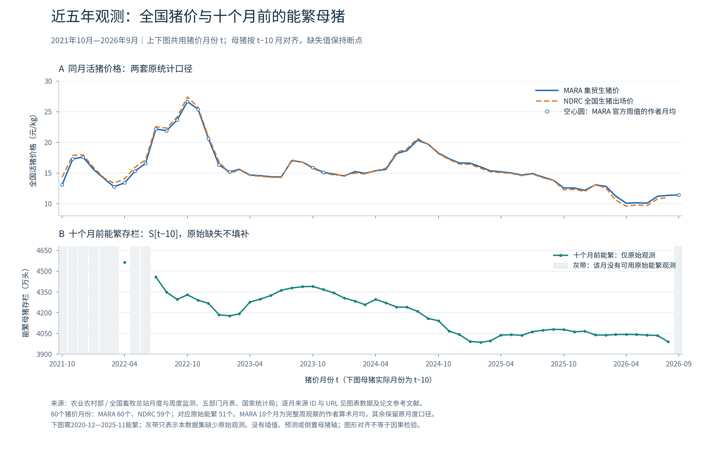
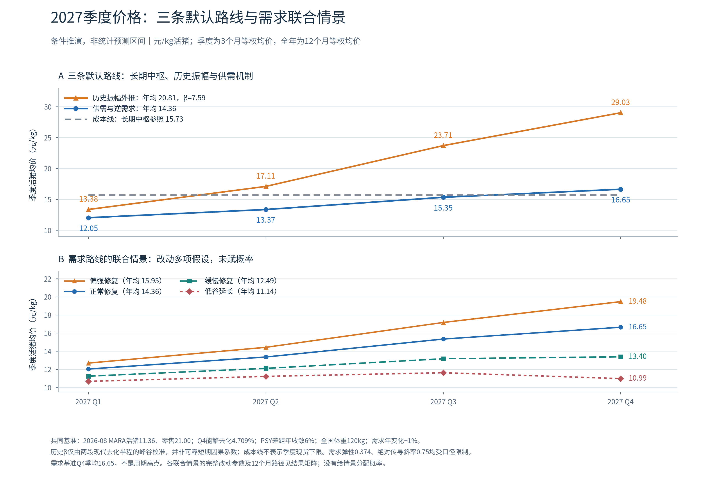

# 1.4.0修订：叙述、逐项数据出处及资产折旧批次

本版替代上一版当前参照。资料冻结2026-10-24，市场事实未因重算而更新。

# 猪周期、生产效率与牧原股份内在价值

## 基于公开成本调查、有效产能与股权现金流的条件情景研究

修订版 v3，模型1.4.0。

**报告性质：** 可复核的研究工作论文。**资料截止日：** 2026年10月24日（北京时间，UTC+8）。**价格情景期：** 2027年。**显性估值期：** 2027—2036年。**计算引擎：** Pig Cycle Lab 1.4.0；本报告另附逐项假设复算脚本及数据快照。

本文中的“研究参照”是一组用于比较条件变化的参数设定。金额除特别注明外为亿元，价格和成本为元/公斤活重，销量和母猪为万头，每股价值为元/股。主要计算保留原始精度，正文通常四舍五入至两位小数。

## 研究假设

| 假设 | 在本文中的严格解释 |
| --- | --- |
| H1：政府制定的保有量指标具有合理性 | 将政策目标视为对正常消费、生产效率与供需稳定的综合判断，作为数量参照。 |
| H2：养殖主体以赚钱为目的 | 主体比较未来经营收益、退出收益、融资成本与风险，依据预期回报作出决策。 |
| H3：主体可使用的资本有限 | 经营亏损、扩张和债务偿还都需要可用现金、融资或资产处置提供资金。 |

各部分的参数取值、情景组合规则与关键结果对照集中列于附录E。本修订版采用1.4.0计算引擎重新计算所有估值。

---

## 摘要

本文建立“公开成本调查—有效生产能力—猪价—公司实现售价—利润—再投资—股权价值”的可复核分析框架。首先，以神农集团披露的六项完全成本构造120公斤商品猪归一化账户，并利用浙江、沈阳、山东等官方调查约束不同成本假设。其次，将能繁母猪、PSY/MSY、成活、商品化和出栏重量分开，比较长期必要产能成本、历史有效产能振幅和需求弹性三条价格路线。再次，将全国猪价转换为公司实现售价，分别分析完全成本、商品猪销量、重量、利润归属与非养殖业务对利润的影响。最后，用逐年FCFE、正常利润PE、ROE–PB/剩余收益和EV/EBITDA讨论牧原的持续经营价值、成长价值与情绪化定价。

在明确的演示假设下，三条价格路线分别给出15.73元/公斤的成本中枢、14.36元/公斤的2027需求路线均价、20.81元/公斤的历史振幅外推均价。差异主要来自价格锚、函数和时间尺度，三者构成方法与假设的对照。2027需求路线的四季均价约为12.05、13.37、15.35、16.65元/公斤，均按季度内月度价格等权计算。在8000万头、120公斤、售价差为0、首年成本11.8元/公斤及95%复合折算下，首年利润约233.08亿元。保持8000万头，2029年全国价修复至15.5元/公斤，采用首年11.8元/公斤的基准经营输入，并按存量到期、新增及更新资产调整后续折旧和利润并扣除必要再投资后，FCFE条件价值约59.50元/股；2031年增至9000万头、增量投资2000元/年销量头且提前支付，对应约62.74元/股，纯销量成长增加约3.24元/股。

研究表明，政策目标、逐利行为与资本约束为价格分析提供共同前提，具体价格需要结合供需函数、成本分布和预期求解。地区成本调查为成本量级提供参照，全国边际成本的识别还需要各成本档的供应权重。历史部分以两个可直接比较的现代去化阶段进行条件校准，情景概率的估计有待更多同口径周期样本和全国月度MSY资料。美国经验用于讨论规模化、行业成熟度和资本回报；牧原的未来份额与估值继续采用公司自身的经营与资本假设。本文形成了一套可修改、可追溯的条件推理体系。

**关键词：** 猪周期；完全成本；能繁母猪；PSY；MSY；需求弹性；资本约束；牧原股份；成长价值；股权自由现金流。

## 先读主线：边际成本中枢与周期高点外推

本条主线先固定一组条件，连续计算到底，再在后文补充其他方法。

1. 必要产能完全成本14.9元/公斤，权益资本1000元/年产能头，要求回报10%，归一化重量120公斤，得到正常猪价中枢14.9+1000×10%/120=15.733333元/公斤。
2. 额外采用源报告的**全年高位价20元/公斤**示例，相当于中枢上浮27.1186%。这一高位价格是独立情景，边际成本本身并未识别上浮比例，也不能把某日或某季20元自动当全年20元。
3. 公司售价差设0，商品猪8000万头、120公斤，共96亿公斤。收入1920亿元，完全成本96×11.8=1132.8亿元，折算前利润787.2亿元，95%复合归属折算后为747.84亿元。
4. 高位年度利润乘10倍PE，股权外推定价7478.4亿元，除57.72996144亿股，得到**129.541053元/股**。这组定价反映高位年度利润与所选倍数，不等于已经验证的持续经营现金流价值。

主线至此完整走完。后文再分别补充母猪与效率、历史振幅、需求价格、实际销售权重、成长投资及现金流折现。每次比较明确指出改变了哪项条件。

### 阅读导航

- [1. 引言：需要解释的是哪一种价格与哪一种价值](#paper-section-1)
- [2. 数据、统计口径与复核方法](#paper-section-2)
- [3. 完全成本：从120公斤账户到有证据约束的效率差异](#paper-section-3)
- [4. 从母猪头数到有效生产能力](#paper-section-4)
- [5. 价格方法一：必要边际产能成本与长期中枢](#paper-section-5)
- [6. 价格方法二：多个历史阶段、有效产能与振幅](#paper-section-6)
- [7. 价格方法三：有效供给、需求弹性与价格传导](#paper-section-7)
- [8. 将价格结果组织成可解释的联合情景](#paper-section-8)
- [9. 从全国猪价到牧原收入与利润：逐项假设分析](#paper-section-9)
- [10. 牧原成长：历史、生产能力、美国经验与资本回报](#paper-section-10)
- [11. 资本有限如何进入计算：从利润到股权现金流](#paper-section-11)
- [12. 估值模型、假设与条件结果](#paper-section-12)
- [13. 综合讨论：怎样让结论受到现实约束](#paper-section-13)
- [14. 稳健性、数据缺口与可证伪条件](#paper-section-14)
- [15. 结论](#paper-section-15)
- [附录A. 本报告与计算网页的对应关系](#paper-section-16)
- [附录B. 复算材料与步骤](#paper-section-17)
- [附录C. 全部计算参数账本](#paper-section-18)
- [附录D. 视频转写建议：55分钟](#paper-section-19)
- [附录E. 研究参数、情景组合与关键结果对照](#paper-section-20)
- [参考文献与数据来源](#paper-section-21)

<a id="paper-section-1"></a>

## 1. 引言：需要解释的是哪一种价格与哪一种价值

### 1.1 研究问题

本研究依次回答六个问题：一头120公斤商品猪的完整生产成本如何构成；哪些生产能力在长期均衡中仍然需要保留；母猪去化在效率和重量变化后代表多少有效供给减少；有效供给变化对应怎样的价格条件；全国价格如何转为牧原利润；利润中有多少可以成为股东现金流以及成长需要付出什么资本。

这些问题存在因果联系，各环节具有不同的时间尺度。饲料成本可以较快影响现金支出，母猪调整通过繁育和育肥批次传导，市场价格还受压栏、二次育肥和需求时点影响，新增栏舍则可能跨多个年度回收投资。因此，从母猪数量变化推导猪价和股价，需要逐一说明效率、需求、成本和资本投入等中间条件。

### 1.2 三种价值概念

**当期交易价格**是市场此时愿意支付的金额，包含预期、情绪、流动性和风险偏好的变化。**条件内在价值**是某组经营和资本假设下，未来股东现金流的折现值。**安全边际**是投资者要求的买入价折让，在完成经营估值后单独表达。经营假设反映企业可能的表现，价格折让反映投资者愿意承担的风险。

持续经营、合理利润、正常融资和技术优势都是估值所需的条件。审慎情景下的内在价值应由这些条件共同确定；清算价值、受融资约束的重组价值和正常持续经营价值分别对应不同的资产处置方式、融资安排和现金流路径。

### 1.3 方法定位

本文采用结构化情景分析、会计恒等式、官方数据描述和历史对照，检验参数组合的内部一致性，并计算结果对各项参数的敏感程度。文中的系数和结果按来源分别标为观测、文献估计或情景设定；因果识别、统计区间和发生概率需要另行设计样本与检验。

### 1.4 命题：确定均衡价格所需的补充条件

给定政策数量S*、同口径生产率M*和重量W*，它们确定一个供给量Q*。任取一个正价格p，都可以构造一条经过该数量点的需求函数Dₚ(P)=Q*(P/p)^(−ε)。再选择与p相容的必要产能成本和正常资本回报，就能得到相同政策数量、主体逐利且资本有限、但均衡价格不同的经济环境。例如13元与17元可以分别配上不同的需求水平和成本体系，且同时满足三条前提。因此，在接受政策目标合理性的基础上，价格识别还需要需求与成本信息。

若进一步加强H1，假定“大多数主体在正常保有量下获得合理利润”，令每个主体的盈亏要求为Cᵢ+Rᵢ，其成本要求分布为F，则至多先得到F(P*)大于某个占比门槛的约束；仍需确定按场户数、母猪数还是有效商品猪公斤数加权，以及究竟需要哪些边际产能。场户数量上的多数与供应量上的多数可能不同。

因此本文的补充条件保持显式：成本法补充必要产能成本与权益回报；历史法补充可比阶段及函数稳定性；需求法补充需求水平、弹性、效率和传导。后文各表计算的是这些补充条件成立时的结果。

<a id="paper-section-2"></a>

## 2. 数据、统计口径与复核方法

### 2.1 证据层级

优先采用主管部门统计、发行人财务报告和投资者关系记录、官方农业成本调查、USDA统计与研究。官方转载与发行人原文镜像保留原始出处和访问URL；研究者归一化、算术推导及情景输入分别标注。公司披露按其经营范围使用，调查结果按其地区、样本和时期解释；全国推断另需代表性与产能权重。

完整历史整理覆盖2015年1月至2026年9月共141个月。其中MARA猪价有138个月，NDRC出场价有66个月，全国绝对母猪数有55个月，旧监测分段指数有57个月，真实全国月度MSY为0个月。缺失月份保留空值，旧样本指数与全国万头数分列；周数据生成的研究者月均与官方直接公布月均分别标注。详见附录数据文件和逐行来源索引。

### 2.2 必须分开的变量

| 变量 | 本文定义 | 统一口径的方法 |
|---|---|---|
| 全国活猪价P | 同一调查体系的元/公斤活重 | 零售猪肉、白条和期货价格分别建列，并明确转换关系 |
| 公司实现售价Pᴹ | 公司实际销售公斤加权收入/公斤 | 按销售时点、地区、产品及公斤量计算公司售价 |
| 完全成本C | 与销售范围、重量、期间匹配的单位成本 | 明确生产成本、完全成本、经济成本和现金成本的项目边界 |
| 商品猪销量V | 达到商品猪销售阶段的头数 | 商品猪、仔猪、种猪及屠宰量分别统计 |
| 出栏重量W | 每头销售活重 | 头数与重量共同决定有效供给公斤量 |
| PSY | 每母猪年提供的断奶仔猪数 | 从断奶阶段继续计算后续成活与商品化 |
| MSY | 指定母猪分母下的年度商品猪数 | 比较前统一母猪分母和商品化定义 |
| NI | 归属于普通股股东的利润 | 由集团净利润与经营利润明确桥接至归属口径 |
| FCFE | 在维持与增长投入后可供股东的现金流 | 由利润逐项调整非现金项目、资本支出、营运资金和净融资 |

### 2.3 单位检查与基本恒等式

若V以万头计、W以公斤/头计，则销售公斤量K以亿公斤计：

$$
K=VW/10000.
\tag{1}
$$

8000万头×120公斤=96亿公斤。每公斤收入或成本变化1元，折算前利润变化96亿元；在α=95%演示条件下，折算后为91.2亿元。每股价值使用亿元除以亿股，直接得到元/股。

价格、利润、现金流及股本的时间口径也要一致：本文使用2026年9月股本与2026H1净资产作为统一、可复算的估值锚。推演至2026年末时，融资、分红和资产变动需要另行更新。

<a id="paper-section-3"></a>

## 3. 完全成本：从120公斤账户到有证据约束的效率差异

### 3.1 假设C-A：以神农披露作为120公斤归一化模板

神农2025H1披露六项成本合计12.4元/公斤。本文按120公斤统一重量，将各项每公斤成本换算为每头金额。[1](#ref-1)

| 项目 | 元/公斤 | 120公斤展示：元/头 | 完全成本占比 |
| --- | --- | --- | --- |
| 仔猪成本 | 2.90 | 348.00 | 23.39% |
| 饲料成本 | 6.70 | 804.00 | 54.03% |
| 动保 | 0.30 | 36.00 | 2.42% |
| 人工 | 1.50 | 180.00 | 12.10% |
| 折旧 | 0.20 | 24.00 | 1.61% |
| 总部费用 | 0.80 | 96.00 | 6.45% |
| 合计 | 12.40 | 1,488.00 | 100% |

仔猪成本代表繁育阶段转入保育育肥的成本，已经归集母猪饲料、母猪折旧和繁殖阶段人工等项目。总部费用也已进入完全成本，管理、财务和销售费用的后续调整须与原披露范围逐项勾稽。公司采用代养模式时，农户资产和人工的补偿可能体现在服务费用中，分析人工效率时应分别识别工资、服务报酬和资产使用补偿。[2](#ref-2) [3](#ref-3) [4](#ref-4) [5](#ref-5)

六项里的“折旧0.2”是该成本账户的直接列示项目。繁育折旧可能随仔猪转入，代养成本也含农户资产使用补偿。12.4减0.2所得12.2表示扣除这一列示项目后的成本；完整现金成本与现金流则从同范围利润、全部相关非现金项目和资本支出逐项桥接。

**适用范围：** 解释成本结构，展示PSY和料肉比对各成本项目的作用。全国边际成本、牧原成本及全国各成本档位的产能权重分别采用对应主体和统计范围的证据。

### 3.2 假设C-B：以官方实际调查约束成本量级

| 样本/期次 | 成本范围 | 原重kg | 元/头 | 元/kg | 120kg等比例金额 | 来源 |
| --- | --- | --- | --- | --- | --- | --- |
| 浙江省 2025-03 | 饲养成本；未分档 | 141.68 | 2,234.13 | 15.7688 | 1,892.26 | [6](#ref-6) |
| 浙江省 2025-09 | 饲养成本；未分档 | 141.10 | 2,111.72 | 14.9661 | 1,795.93 | [7](#ref-7) |
| 浙江省 2026-04 | 饲养成本；未分档 | 142.24 | 2,111.35 | 14.8436 | 1,781.23 | [8](#ref-8) |
| 辽宁沈阳 2025 | 饲养总成本；未分档 | 138.97 | 2,134.01 | 15.3559 | 1,842.71 | [9](#ref-9) |
| 山东省 2026Q2 | 出售肥猪成本；规模猪场，未分大中小 | 125.24 | 未披露 | 12.7400 | 1,528.80 | [10](#ref-10) |

浙江为省内定点场户月报，其“饲养成本”按调查范围解释；与上市公司完全成本比较时，先勾稽各项费用范围。2026年4月2111.35元/头与142.24公斤来自同一期；相除得到14.8436元/公斤，乘120得到1781.23元。这是等比例展示金额；若真的改为120公斤出栏，后段料肉比、天数、死亡风险和固定摊销会变化，成本反事实需要重新建模。[6](#ref-6) [7](#ref-7) [8](#ref-8)

沈阳调查涉及12户，物质与服务费1779.68元、人工340.77元与总成本2134.01元之间的13.56元列为待细分项目。副产品收入10.24元若抵减，总成本口径的15.3559元/公斤变为主产品保本15.2822元/公斤。现金工资的还原需要家庭用工与雇工的进一步拆分；经济成本中的家庭劳动折价按劳动机会成本解释。[9](#ref-9)

这些样本展示了现实成本差异，差异中包含地区、时期、饲料、猪苗、规模、重量和会计范围等因素。判断浙江等地在全国成本分布中的位置，以及14.9元产能是否为满足需求所必需，都需要进一步匹配全国同口径样本与供给权重。

### 3.3 假设C-C：采用山东公开的标准化120公斤预算

| 项目 | 自繁自育：元/头 | 外购仔猪：元/头 |
| --- | --- | --- |
| 仔猪 | 280 | 230 |
| 饲料 | 900 | 900 |
| 疫苗 | 20 | 20 |
| 药品 | 20 | 20 |
| 生物安全 | 20 | 15 |
| 水电 | 25 | 25 |
| 人工 | 65 | 55 |
| 折旧 | 55 | 45 |
| 财务 | 25 | 20 |
| 低值消耗与维修 | 20 | 20 |
| 死亡淘汰损失 | 25 | 20 |
| 合计 | 1455 | 1370 |
| 除120：元/kg | 12.1250 | 11.4167 |
| 原文额外3%后：元/kg | 12.49 | 11.76 |

山东2026Q2材料将标准化预算与实际监测分开：自繁自育预算1455元/头，外购仔猪1370元/头，除以120分别为12.125和11.4167元/公斤；原文另加3%后为12.49和11.76。同期实际规模场监测为125.24公斤、12.74元/公斤。3%按原材料中的额外调整项处理，股东要求回报与情景权重另设参数。[10](#ref-10)

自繁与外购的成本排序还会随仔猪市场变化。2025Q1预算分别为1523和1630元/头，2025Q3为1600和1710元/头，而2026Q2外购预算更低。这一成本排序变化与仔猪市场价格有关。仔猪价格吸收了对未来猪价、母猪供给及育肥利润的预期，技术效率比较则需要控制采购时点和仔猪价格。[11](#ref-11) [12](#ref-12)

### 3.4 假设C-D：构造不同生产效率下的技术成本组合

为了说明技术影响，令s为断奶后成活率、u为利用率、d为饲养天数指数、l为人工价格指数、h为动保强度指数、f为饲料价格指数。以神农成本账户校准：

$$
\begin{aligned}
A_s &= 0.95/s, \\
F &= (0.90/u)dA_s, \\
M &= \frac{1+0.5(1-s)/s}{1+0.5(0.05/0.95)}.
\end{aligned}
\tag{2}
$$

$$
\begin{aligned}
C_{\text{仔猪}} &= 2.9(0.25+0.75\times29/PSY)A_s, \\
C_{\text{饲料}} &= 6.7(FCR/2.45)Mf, \\
C_{\text{动保}} &= 0.3hA_s, \\
C_{\text{人工}} &= 1.5(0.3+0.7F)l, \\
C_{\text{折旧}} &= 0.2F, \\
C_{\text{总部}} &= 0.8F, \\
C &= \sum_j C_j.
\end{aligned}
\tag{3}
$$

25%/75%的繁育可变与固定分摊、30%/70%的人工分摊、死亡猪平均消耗正常饲料的一半均为模型假设。PSY29与FCR2.45参考另一披露时点，成活95%和利用率90%为校准条件，四者共同构成本文的技术演示组合。[13](#ref-13)

本技术演示把2.45作为生物FCR校准参考并固定入栏与出栏重量关系；死淘耗料是否已包含在原披露FCR中，列为待核实的口径项。FCR以增重为物理分母，完全成本以出栏活重为分母。若采用已含死亡耗料的经济FCR，则由该指标统一计入死亡损耗；若改变重量，应同步重算增重与出栏重的比例。

| 组合 | PSY | FCR | 断奶后成活% | 利用率% | 完全成本 | 加正常权益回报后 |
| --- | --- | --- | --- | --- | --- | --- |
| A | 31 | 2.40 | 96 | 95 | 11.83 | 12.66 |
| B | 29 | 2.45 | 95 | 90 | 12.40 | 13.23 |
| C | 26 | 2.65 | 93 | 85 | 13.69 | 14.52 |
| D | 23 | 2.85 | 90 | 80 | 15.26 | 16.09 |
| E | 20 | 3.05 | 86 | 70 | 17.58 | 18.42 |

表中的A—E表示五组技术参数；全国前10%、前25%等效率分位需要另有代表性调查。技术参数同时变化时，成本差额由各项目共同形成：PSY影响繁育成本的相应部分，料肉比作用于饲料成本，利用率作用于固定摊销。生物FCR另计死亡耗料，经济FCR则按其已包含的损耗范围计价。

要把这一演示变成全国供给曲线，至少需要同一期间、同一成本边界、按有效商品猪公斤量加权的样本，并掌握各成本档的可持续供应能力。形式上：

$$
Q(P)=\sum_j q_j\,\mathbf{1}\{P\ge C_j+R_j\}.
\tag{4}
$$

该式用于表示长期必要产能的排序。短期供给路径还需加入继续经营决策、融资约束、退出和再进入成本。全国边际档位的识别以各档q_j权重为基础，后续需要通过全国代表性调查补充这些权重。

### 3.5 完全成本、现金成本与经济成本的三种退出机制

在“售价高于付现经营支出、低于会计完全成本”时，继续生产可能比闲置更少亏；在“会计盈利、低于资金和家庭劳动机会回报”时，主体仍可能长期不愿追加投入；当流动性已经不足以支付必要支出时，即使预期远期有利润，也可能被迫出售资产。这三种机制使H2与H3对应的退出条件随成本结构、预期回报和流动性而变化。

猪粮比、猪料比及其平衡点也有特定成本假设。有效率异质性时，高成本必要产能可能高于某个行业平均平衡点。比较全国边际成本与公布的平衡点，需要先统一成本范围，再识别满足需求所必需的产能在成本分布中的位置。

<a id="paper-section-4"></a>

## 4. 从母猪头数到有效生产能力

### 4.1 假设S-A：PSY、MSY和母猪分母保持可比

在生产阶段和分母完全一致、已经作同批次桥接或稳态年化近似时，可以写成：

$$
MSY=PSY\times s_{\text{断奶后}}\times q_{\text{商品化}}\times u_{\text{分母桥接}}.
\tag{5}
$$

这里u用于桥接PSY母猪分母与全国能繁统计的差异，同一闲置或生产率损失在对应参数中计入一次。PSY以断奶仔猪为起点，后续连接断奶后的成活和商品化。若直接输入同口径MSY，则由MSY统一替代式(5)中的因子组合。

年度出栏/年末母猪的比值使用了多批次流量与时点存量，适合用作粗略的产出量级参照。真实MSY需要匹配繁育批次与母猪年分母。历史文件中的“年度出栏/滞后母猪均值”包含当年实际出栏，预测时应按当时可获得的数据确定输入。

### 4.2 假设S-B：效率提高，但向有限水平收敛

| 参照 | PSY | 统计对象 | 来源 |
| --- | --- | --- | --- |
| 中国 · 2025 | 23.40 | 经产母猪，规模场与散户加权 | [14](#ref-14) |
| 牧原 · 2025 | 28.30 | 公司全年 PSY | [15](#ref-15) |
| 神农 · 2025 | 29.50 | 公司全年 PSY | [16](#ref-16) |
| 北美 PigCHAMP · 2025 | 28.19 | 149场；已配母猪均值 | [17](#ref-17) |
| 北美PigCHAMP · 2025 全部母猪 | 26.88 | 149场，全部母猪分母 | [17](#ref-17) |
| 荷兰 InterPIG · 2025 | 33.50 | 母猪年；国家行业基准 | [18](#ref-18) |
| 法国 IFIP · 2024 | 33.50 | 1345场；生产母猪均值 | [19](#ref-19) |
| 丹麦 SEGES · 2025 | 36.90 | 703场；母猪年加权均值 | [20](#ref-20) |
| DanBred 前10% · 2024 | 41.90 | 领先组均值 | [21](#ref-21) |

国际参照说明先进水平与国内均值存在距离，同时也显示分母和样本的重要性。北美同一调查的全部母猪与已配母猪口径即可产生不同PSY；领先组均值、90分位门槛、前几场平均也各有统计含义。丹麦、法国、荷兰的经验可用于设定先进效率参照，中国平均效率的改善速度则需要结合国内场户结构和技术扩散路径。[17](#ref-17) [20](#ref-20) [19](#ref-19) [18](#ref-18) [21](#ref-21)

本文用有界路径：

$$
PSY(y)=PSY_0+(PSY_{max}-PSY_0)[1-(1-k)^y].
\tag{6}
$$

实际计算取y=(价格月份−2026年8月)/12。2025文献的23.4在此借作2026年8月相对效率归一化起点，模型从这一锚点开始累计增长。

基准PSY₀=23.4、PSYmax=32、k=6%，一年后23.916，增幅2.205%。32是分析期内设定的收敛水平。若育种继续进步，未来可更新收敛水平；若疫病和组织瓶颈存在，路径也可能停滞或倒退。

### 4.3 假设S-C：不变效率、直接MSY与更快追赶分别讨论

**效率不变**令相对MSY为1，用于检验“母猪下降完全转化为产能下降”的上界式机制；在其他条件相同时，这通常提高猪价。**直接MSY**假定18在一年内提高到18.4，之后保持，以统一商品猪产出指标处理效率。**更快追赶**提高差距收敛速度，降低每头母猪去化对应的有效供给降幅；它可以来自主体内部效率改善，也可以来自低效主体退出后的构成变化，两类作用需按各自贡献归集。

### 4.4 假设S-D：体重与母猪数量分别变化

国内相对有效公斤供给：

$$
E_t=\frac{S_{t-\ell}}{S_{base}}\frac{MSY_t}{MSY_{base}}\frac{W_t}{W_{base}}.
\tag{7}
$$

10%的母猪减少、3%的MSY提高和5%的体重提高，对应有效公斤量0.90×1.03×1.05=0.97335，减少2.665%，小于母猪数量10%的降幅。这组独立因子演算展示了效率与体重的抵消作用；若提高重量延长周转、挤占出栏或增加死亡，必须连同相关成本和数量调整。

全国重量变化用于供给，公司重量变化用于利润分母，两个输入分别设定并按实际销售结构建立联系。公司通过压栏增重提升公斤量时，应同步评估头数周转、单位成本和售价溢价的变化。

### 4.5 假设S-E：以十个月为中心比较生产传导时滞

固定10个月下，2027Q1对应2026年3—5月母猪，Q2对应6—8月，Q3对应9—11月，Q4对应2026年12月至2027年2月。四季度去化影响主要落在后续价格月份；情景路径中的缺失月按季度点插值，并保留其插值状态。

分布滞后可写为：

$$
\begin{aligned}
L_t ={}& 0.1S_{t-8}+0.2S_{t-9}+0.4S_{t-10} \\
&+0.2S_{t-11}+0.1S_{t-12}.
\end{aligned}
\tag{8}
$$

权重为演示设定，后续可用完整批次数据估计。母猪年龄、配种率、生产周期、出栏策略和留种都会改变传导。本文既保留用户提出的10个月主线，也报告8、12个月和分布滞后的结果。

<a id="paper-section-5"></a>

## 5. 价格方法一：必要边际产能成本与长期中枢

### 5.1 假设P-C1：必要产能可以获得合理的权益资本回报

令Cₘ为满足需求所必需的产能之同口径完全成本，Eₕ为每头年销量能力投入的权益资本，rₑ为所需权益回报，固定归一化重量为120公斤：

$$
P_{cost}=C_m+\frac{E_hr_e}{120}.
\tag{9}
$$

本式采用已含债务利息的Cₘ，并单列权益机会回报。若调查经济成本已包含同一资金机会成本，则先将该项剥离，再按统一要求回报计入。采用全资本ROIC时，成本应调整为融资费用前的经营成本，资本分母相应采用全资本投入。

在Cₘ=14.9、Eₕ=1000、rₑ=10%时，正常回报为100元/头、0.833333元/公斤，中枢为15.733333元/公斤。这里的关键判断其实有两个：14.9元的产能是否仍被市场需要；1000元权益资本是否足以支持相应年销量。这两项是该中枢测算需要独立验证的经济条件。

### 5.2 假设P-C2：不同必要成本对应不同中枢

| 必要完全成本Cₘ | 每头正常回报 | 每公斤正常回报 | 条件中枢 |
| --- | --- | --- | --- |
| 12.50 | 100元 | 0.8333 | 13.3333 |
| 13.00 | 100元 | 0.8333 | 13.8333 |
| 14.00 | 100元 | 0.8333 | 14.8333 |
| 14.90 | 100元 | 0.8333 | 15.7333 |
| 15.50 | 100元 | 0.8333 | 16.3333 |
| 16.00 | 100元 | 0.8333 | 16.8333 |

这一表格把“成本判断”与“资本回报要求”分开。较低中枢可以来自先进产能足以满足需求，也可以来自饲料便宜；较高中枢可以来自供给仍需要较贵产能。必要成本档位应依据市场需求、各档产能及供应持续性确定，地区均值可为这一判断提供调查参照。

### 5.3 假设P-C3：同一成本下，不同资本与回报要求

| 每头年产能权益资本 | 要求回报8% | 要求回报10% | 要求回报12% |
| --- | --- | --- | --- |
| 500元 | 15.2333 | 15.3167 | 15.4000 |
| 1,000元 | 15.5667 | 15.7333 | 15.9000 |
| 1,500元 | 15.9000 | 16.1500 | 16.4000 |

该表固定Cₘ=14.9、120公斤。改变权益资本与要求回报会改变正常猪价，但需要真实资本结构支持；选择“每头投入很少、却要求很高正常利润”的组合，要解释资本周转和经营范围。

### 5.4 原始政策假设的强版本与弱版本

**弱版本：** 3750万头对应政策判断的正常需求。此时它只提供数量参照，价格仍须由成本与需求函数补足。**强版本：** 进一步假定3750万头在指定PSY、MSY、体重和需求下，对应15.7333元的正常价格。强版本在政策数量参照上补充了本文设定的盈利与价格映射。

当效率提高时，同样消费量对应的合理母猪数应下降。H1下的3750万头应与其效率和消费条件一起使用；随着PSY和需求变化，供需平衡母猪数也应相应调整。政策文本明确允许效率和消费变化后动态调整。[22](#ref-22)

### 5.5 长期成本中枢与短期价格波动

已经形成的生物资产需要出栏，短期可变支出可能低于完全成本，主体可能预期未来恢复，退出需要时间。这些条件允许现货长时间低于正常中枢。相反，供给短缺时现货也可高于必要产能成本。因此成本法用于估计维持必要产能的长期价格，2027Q3等季度价格与本轮高点还需要结合供需路径、季节和库存分析。

<a id="paper-section-6"></a>

## 6. 价格方法二：多个历史阶段、有效产能与振幅

### 6.1 假设P-H1：历史阶段具有足够可比性

| 去化阶段 | 价口径 | 母猪/指数变化 | 价格窗口低→高 | 涨幅 | 默认校准 | 来源 |
| --- | --- | --- | --- | --- | --- | --- |
| 2015-01→2016-02 | MARA | -10.21% | 12.27（2015-03）→20.45（2016-05） | 66.67% | 否：样本/疫情边界 | [23](#ref-23) [24](#ref-24) [25](#ref-25) [26](#ref-26) |
| 2018-03→2019-09 | MARA | -44.06% | 10.57（2018-05）→37.15（2020-08） | 251.47% | 否：样本/疫情边界 | [27](#ref-27) [28](#ref-28) [29](#ref-29) [30](#ref-30) [31](#ref-31) |
| 2021-06→2022-04 | NDRC | -8.48% | 13.34（2022-03）→27.39（2022-10） | 105.32% | 是 | [32](#ref-32) [33](#ref-33) [34](#ref-34) [35](#ref-35) |
| 2022-12→2024-04 | NDRC | -9.20% | 14.26（2023-07）→20.63（2024-08） | 44.67% | 是 | [36](#ref-36) [37](#ref-37) [38](#ref-38) [39](#ref-39) |

2015—2016使用旧监测指数且是截断阶段；2018—2020受到非洲猪瘟多重冲击，两者作为背景对照。默认现代阶段校准采用2021—2022与2022—2024的同口径全国绝对能繁，观察母猪峰到谷与价格谷到峰的对应关系。全部4个历史观察窗口中，现代校准样本为2个去化阶段；MARA与NDRC提供这两个阶段的不同报价口径。

现代两个阶段母猪降幅约8.48%和9.20%，NDRC峰谷价格涨幅却分别约105.32%和44.67%。相近母猪降幅对应的价格涨幅有明显差异，说明效率、需求、库存、压栏和周期起点等条件需要共同纳入解释。各因素的贡献有待进一步识别。

### 6.2 假设P-H2：先修正历史生产效率，再求振幅系数

设一个阶段母猪由Sₐ降至Sᵦ，持续T年，MSY年变化gₕ，累计重量变化wₕ，价格窗口低高点为Pₗ、Pₕ：

$$
\begin{aligned}
e_H &= (S_b/S_a)(1+g_H)^T(1+w_H), \\
\beta_H &= \frac{\ln(P_h/P_l)}{-\ln e_H}.
\end{aligned}
\tag{10}
$$

默认历史MSY每年提高2%，重量不变。MARA两个现代阶段得到β约10.2058和4.9807，中位数7.5932；如果MSY不变，则约8.3051和3.6185。**过去效率改善越多，同样母猪去化代表的有效供给收缩越少，计算出的β反而越大。** 这与“未来效率改善降低未来缺口”的方向不同，两者必须分开讨论。

当有效供给变化接近0时，分母接近0，β可能急剧增大。代码采用有效去化至少2%的数值稳定筛选规则。该校准式适用于有效供给收缩且价格上涨的阶段；其他组合需要引入额外解释机制。

### 6.3 假设P-H3：将事后振幅关系用于未来路径

$$
P_t=P_0E_t^{-\beta}.
\tag{11}
$$

| 假设（其他同参照） | β | Q1 | Q2 | Q3 | Q4 | 年均 |
| --- | --- | --- | --- | --- | --- | --- |
| 历史阶段MSY年增长0% | 5.9618 | 12.91 | 15.66 | 20.23 | 23.73 | 18.13 |
| 历史阶段MSY年增长2% | 7.5932 | 13.38 | 17.11 | 23.71 | 29.03 | 20.81 |
| 历史阶段MSY年增长5% | 13.2209 | 15.13 | 23.30 | 41.11 | 58.19 | 34.43 |
| 只用2021–2022去化半程 | 10.2058 | 14.16 | 19.74 | 30.60 | 40.09 | 26.15 |
| 只用2022–2024去化半程 | 4.9807 | 12.64 | 14.85 | 18.39 | 21.02 | 16.73 |

不同β与效率假设会给出显著不同的结果。默认年度20.81、Q4约29.03元/公斤反映了该函数在当前锚下的放大作用，其预测用途需要额外的样本外检验。该路线将历史需求、进口和传导等共同影响吸收到β中，解释结果时应按这种综合振幅口径使用。

### 6.4 严格十个月端点检验与峰谷振幅的比较

| 母猪阶段 | 严格+10月价格端点 | NDRC端点价格 | 端点变化 | 另选窗口峰谷变化 |
| --- | --- | --- | --- | --- |
| 2021-06→2022-04 | 2022-04→2023-02 | 14.06→14.90 | 5.9744% | 105.32% |
| 2022-12→2024-04 | 2023-10→2025-02 | 15.78→15.77 | -0.0634% | 44.67% |

两个现代去化阶段的NDRC严格+10个月端点价格变化约为+5.97%和−0.06%，远小于各自峰谷上涨105.32%和44.67%。两种计算回答不同问题：峰谷法描述窗口内实现的最大振幅，端点法检查预先指定日期之间的价格变化。将窗口振幅用于未来逐月价格，需要另行验证这种映射关系。

### 6.5 同样本滞后对照

| 时滞 | 同目标月份数 | 相关系数r | R²（仅描述） |
| --- | --- | --- | --- |
| fixed_8 | 34 | -0.8054 | 0.6486 |
| fixed_10 | 34 | -0.5699 | 0.3248 |
| fixed_12 | 34 | -0.2724 | 0.0742 |
| distributed_8_12 | 34 | -0.5802 | 0.3367 |

上表使用同一批34个目标月份，比较同比对数变化。8个月在这一样本相关更强；稳定时滞的选择仍需更多周期和批次证据。重叠同比数据具有序列相关，统计区间应采用相应的时间序列方法。已有时间留出检验覆盖6—8个月，各滞后的缺失月份也有差异，后续应扩充共同样本以比较模型稳定性。



**图1说明：** 价格显示2021年10月至2026年9月；下图在价格月份t展示Sₜ₋₁₀。历史缺失值保留断点，价格与万头数分别使用上下两个面板。该图展示时间对应关系，MSY、重量和需求在后续模型中单独讨论。原始数据与逐行来源见附件。

### 6.6 对这条路线的使用判断

历史振幅路线用于测算重现某次历史振幅时的价格范围，并展示效率假设对结果的影响。季度路径由需求路线补充，长期中枢由必要产能成本法约束。报告分别呈现各路线结果，按其经济机制相互参照。

<a id="paper-section-7"></a>

## 7. 价格方法三：有效供给、需求弹性与价格传导

### 7.1 假设P-D1：供需变化先映射为零售价格

令m为基期进口占比，gᵢ为进口增长，gᴅ为固定价格下需求趋势，y为距2026年8月的年数：

$$
\begin{aligned}
Q_t &= (1-m)E_t+m(1+g_I)^y, \\
D_t &= (1+g_D)^y, \\
z_t &= Q_t/D_t.
\end{aligned}
\tag{12}
$$

在常弹性逆需求下：

$$
\begin{aligned}
R_t &= R_0z_t^{-1/\varepsilon}, \\
P_t &= P_0+\lambda(R_t-R_0).
\end{aligned}
\tag{13}
$$

R是零售猪肉价格，P是活猪价格。ε=0.374参考USDA对中国年度家庭需求的研究，λ=0.75是本研究传导假设。将年度家庭零售弹性用于月度整体市场属于跨口径应用，需通过月度市场数据进一步检验；本次计算将其作为明确的情景条件。[40](#ref-40)

基期附近、暂忽略进口的局部有效产能价格系数为λR₀/(εP₀)，约3.71，低于默认历史β约7.59。两种方法因此可能明显分歧，差异应从机制、时间尺度与校准选择分别解释。

### 7.2 假设P-D2：Q4与Q3同速去化

$$
\begin{aligned}
d_{Q3} &= 1-3602/3780 \\
&= 4.708994709\%, \\
S_{2026-12} &= 3602(1-d_{Q3}) \\
&= 3432.382011.
\end{aligned}
\tag{14}
$$

3432.38万头是情景值，略低于3750×92%=3450万头的政策绿色区域下沿。后续母猪路径需要结合政策响应、补栏利润和效率变化重新设定，同速去化假设在本节用于2026Q4。[22](#ref-22)

| 价格月份 | 对应母猪月份 | 母猪万头 | 相对MSY | 有效产能比E | 全国价 |
| --- | --- | --- | --- | --- | --- |
| 2027-01 | 2026-03 | 3,904.00 | 1.0094 | 0.9876 | 11.7023 |
| 2027-02 | 2026-04 | 3,862.67 | 1.0112 | 0.9789 | 12.0416 |
| 2027-03 | 2026-05 | 3,821.33 | 1.0130 | 0.9702 | 12.3935 |
| 2027-04 | 2026-06 | 3,780.00 | 1.0149 | 0.9614 | 12.7588 |
| 2027-05 | 2026-07 | 3,720.67 | 1.0167 | 0.9480 | 13.3608 |
| 2027-06 | 2026-08 | 3,661.33 | 1.0185 | 0.9346 | 13.9966 |
| 2027-07 | 2026-09 | 3,602.00 | 1.0203 | 0.9211 | 14.6686 |
| 2027-08 | 2026-10 | 3,545.46 | 1.0221 | 0.9082 | 15.3389 |
| 2027-09 | 2026-11 | 3,488.92 | 1.0238 | 0.8953 | 16.0467 |
| 2027-10 | 2026-12 | 3,432.38 | 1.0256 | 0.8823 | 16.7949 |
| 2027-11 | 2027-01 | 3,432.38 | 1.0274 | 0.8838 | 16.6531 |
| 2027-12 | 2027-02 | 3,432.38 | 1.0291 | 0.8853 | 16.5129 |

首年的同比效率改善使用距离2026年8月的时间，因此2027年12月相对效率改善略高于2027年8月。Q4母猪情景持平后，效率继续改善且需求趋势为负，模型内月价会略回落：最高模型月均约为10月16.79元/公斤，Q4均价为16.65元/公斤。该峰值的统计单位为模型月均价，周价、日价和完整周期顶点需要更高频率及更长时间范围的数据。

### 7.3 单因素一：去化速度

| 假设（其他同参照） | Q1 | Q2 | Q3 | Q4 | 年均 |
| --- | --- | --- | --- | --- | --- |
| Q4停止去化 | 12.05 | 13.37 | 14.54 | 14.16 | 13.53 |
| Q4延续Q3比例 | 12.05 | 13.37 | 15.35 | 16.65 | 14.36 |
| Q4去化比例翻倍 | 12.05 | 13.37 | 16.25 | 19.63 | 15.32 |

Q4去化变化主要影响2027下半年，Q1供给则主要由更早的母猪批次决定。Q4去化为0的情景仍继承2026前三季度已发生的母猪下降，因此后续供给继续包含此前去化的滞后影响。

### 7.4 单因素二：效率及体重

| 假设（其他同参照） | Q1 | Q2 | Q3 | Q4 | 年均 |
| --- | --- | --- | --- | --- | --- |
| 每年缩小PSY差距0% | 12.53 | 14.16 | 16.51 | 18.19 | 15.35 |
| 每年缩小PSY差距6% | 12.05 | 13.37 | 15.35 | 16.65 | 14.36 |
| 每年缩小PSY差距12% | 11.56 | 12.62 | 14.28 | 15.28 | 13.43 |
| 直接MSY一年由18到18 | 12.53 | 14.16 | 16.51 | 18.19 | 15.35 |
| 直接MSY一年由18到18.4 | 12.05 | 13.37 | 15.38 | 16.93 | 14.43 |
| 直接MSY一年由18到18.9 | 11.48 | 12.46 | 14.07 | 15.49 | 13.38 |

| 假设（其他同参照） | Q1 | Q2 | Q3 | Q4 | 年均 |
| --- | --- | --- | --- | --- | --- |
| 一年后全国出栏重120kg | 12.05 | 13.37 | 15.35 | 16.65 | 14.36 |
| 一年后全国出栏重125kg | 11.19 | 12.00 | 13.40 | 14.52 | 12.78 |
| 一年后全国出栏重130kg | 10.41 | 10.78 | 11.71 | 12.68 | 11.40 |

效率增长0、默认追赶、更快追赶分别描述三种生产路径。对全国猪价，效率更高可能压低价格；对牧原成本，效率提升可能增加利润。现模型分别设定全国效率与公司成本，二者的联动幅度需要根据公司的实际技术改善另行确定。

体重敏感性固定其他变量，是为了观察公斤供给的净影响。实际出栏更重还可能带来不同售价、料肉比和销售推迟；若据此形成完整公司利润情景，还需要在公司参数中联动。

### 7.5 单因素三：需求、弹性与传导

| 假设（其他同参照） | Q1 | Q2 | Q3 | Q4 | 年均 |
| --- | --- | --- | --- | --- | --- |
| 需求年变化0% | 12.27 | 13.73 | 15.89 | 17.37 | 14.82 |
| 需求年变化-1% | 12.05 | 13.37 | 15.35 | 16.65 | 14.36 |
| 需求年变化-2% | 11.82 | 13.01 | 14.82 | 15.95 | 13.90 |

| 假设（其他同参照） | Q1 | Q2 | Q3 | Q4 | 年均 |
| --- | --- | --- | --- | --- | --- |
| 需求价格弹性绝对值0.2 | 12.67 | 15.34 | 19.65 | 22.69 | 17.59 |
| 需求价格弹性绝对值0.374 | 12.05 | 13.37 | 15.35 | 16.65 | 14.36 |
| 需求价格弹性绝对值0.6 | 11.78 | 12.58 | 13.74 | 14.48 | 13.15 |

0.20、0.60为指定敏感性网格。表观消费的另一估计0.163保存在完整矩阵中，按其估计对象单独解释；0.374对应年度家庭消费口径。

| 假设（其他同参照） | Q1 | Q2 | Q3 | Q4 | 年均 |
| --- | --- | --- | --- | --- | --- |
| 零售→活猪绝对价格斜率0.5 | 11.82 | 12.70 | 14.02 | 14.89 | 13.36 |
| 零售→活猪绝对价格斜率0.75 | 12.05 | 13.37 | 15.35 | 16.65 | 14.36 |
| 零售→活猪绝对价格斜率1 | 12.27 | 14.04 | 16.68 | 18.42 | 15.35 |

较小弹性意味着同一供给缺口引发更大价格波动。家庭外消费、收入、替代肉类、人口及健康偏好都会改变需求；进口和冻品释放则改变可供给量。−1%需求趋势表示固定价格下需求量的年度变化，这些额外机制的贡献需要另行分析。

### 7.6 单因素四：十个月、八个月、十二个月与分布滞后

| 假设（其他同参照） | Q1 | Q2 | Q3 | Q4 | 年均 |
| --- | --- | --- | --- | --- | --- |
| 固定8个月 | 12.75 | 14.57 | 16.38 | 16.26 | 14.99 |
| 固定10个月 | 12.05 | 13.37 | 15.35 | 16.65 | 14.36 |
| 固定12个月 | 11.89 | 12.69 | 14.34 | 16.43 | 13.84 |
| 8–12个月母猪数量分布滞后 | 12.18 | 13.50 | 15.42 | 16.61 | 14.43 |

改变滞后时，观测锚的对应母猪基月也随之移动。3990是默认滞后对应的母猪基期，其他滞后使用各自匹配的基月数量。分布滞后基期包含缺失月的插值，其基期状态标为情景加权值。

### 7.7 函数假设：常弹性与局部线性

局部线性形式为：

$$
R_t=R_0[1+(1-z_t)/\varepsilon].
\tag{15}
$$

| 假设（其他同参照） | Q1 | Q2 | Q3 | Q4 | 年均 |
| --- | --- | --- | --- | --- | --- |
| 常弹性逆需求 | 12.05 | 13.37 | 15.35 | 16.65 | 14.36 |
| 局部线性逆需求 | 12.02 | 13.20 | 14.76 | 15.68 | 13.92 |

当缺口很小时两者接近；缺口扩大时，常弹性形式具有更强非线性。两种函数之间的差异用于展示函数选择带来的模型风险。价格超出历史常见范围时，应重新检查需求饱和、进口、库存与替代反应，并据此调整模型。

### 7.8 锚点假设：观测价格与政策成本价格

观测锚使用2026年8月11.36元及对应3990万头。政策锚则假定3750万头对应15.7333元，并保持绝对零售—活猪传导的一致平移：

$$
R_0^{policy}=21+\frac{15.733333-11.36}{0.75}=26.831111.
\tag{16}
$$

26.8311是依上述假设推导的零售锚。政策均衡采用这一零售锚，观测基期采用21元，二者按照同一零售—活猪传导关系转换。

| 假设（其他同参照） | Q1 | Q2 | Q3 | Q4 | 年均 |
| --- | --- | --- | --- | --- | --- |
| 观测价格锚 | 12.05 | 13.37 | 15.35 | 16.65 | 14.36 |
| 政策量+成本价假设锚 | 13.46 | 14.90 | 17.05 | 18.47 | 15.97 |
| 政策锚下必要成本13元/kg | 11.77 | 13.08 | 15.03 | 16.31 | 14.05 |
| 政策锚下必要成本16元/kg | 14.43 | 15.96 | 18.23 | 19.72 | 17.08 |

这组对照直接呈现用户最初想法需要增加的条件：政策数量合理、必要成本判断合理、权益资本回报合理、数量与价格在同一效率状态下对应。政策锚作为这组联合假设下的条件对照，其适用性取决于各项条件的证据支持。

### 7.9 进口与后续母猪路径的独立假设

| 单独变动项 | Q1 | Q2 | Q3 | Q4 | 年均 |
| --- | --- | --- | --- | --- | --- |
| importSharePct=0 | 12.06 | 13.42 | 15.46 | 16.80 | 14.44 |
| importSharePct=2 | 12.05 | 13.37 | 15.35 | 16.65 | 14.36 |
| importSharePct=5 | 12.02 | 13.29 | 15.19 | 16.43 | 14.23 |
| importsGrowthPct=20 | 11.96 | 13.23 | 15.12 | 16.33 | 14.16 |
| importsGrowthPct=-20 | 12.14 | 13.53 | 15.59 | 16.97 | 14.56 |

这些进口数值为外生情景设定，份额按基期占比定义。基期进口更大时，同样国内供给收缩对总供给的影响较小；未来进口增加也可缓冲缺口。进口响应需要境内外价差、渠道和时间，固定份额与未来增量分别计入相应供给项。

| 假设（其他同参照） | Q1 | Q2 | Q3 | Q4 | 年均 |
| --- | --- | --- | --- | --- | --- |
| 2027能繁年变化-5% | 12.05 | 13.37 | 15.35 | 16.89 | 14.41 |
| 2027能繁年变化0% | 12.05 | 13.37 | 15.35 | 16.65 | 14.36 |
| 2027能繁年变化5% | 12.05 | 13.37 | 15.35 | 16.43 | 14.30 |

在默认10个月滞后下，2027母猪路径只通过本年末少数价格月份进入2027结果，更主要的影响落在2028。因而，2027补栏的长期反馈需要重点观察2028及其后的价格路径。

<a id="paper-section-8"></a>

## 8. 将价格结果组织成可解释的联合情景

### 8.1 四组机制及完整变化项

| 联合情景 | Q4去化 | PSY差距年缩小 | 全国目标体重kg | 需求年变 | 首年公司成本 | 修复期 |
| --- | --- | --- | --- | --- | --- | --- |
| 正常修复 | 4.709% | 6% | 120 | -1% | 11.80 | 3年 |
| 缓慢修复 | 2.354% | 8% | 123 | -1.5% | 12.10 | 4年 |
| 低谷延长 | 0.000% | 12% | 124 | -2% | 12.50 | 5年 |
| 偏强修复 | 6.000% | 3% | 119 | 0% | 11.50 | 3年 |

以上四组分别改变去化、行业效率、体重、需求、公司成本及修复速度。其余沿用参数附录中的研究参照，长期全国价均为15.5元，修复后基准成本输入均为11.8元，先按修复期过渡，再按各自资产批次调整折旧与等价完全成本。这组对照用于比较近期周期与公司首年经营差异，长期中枢永久变化另在长期价格敏感性中分析。

| 联合情景 | Q1 | Q2 | Q3 | Q4 | 全国年均 | 首年利润 | 平量FCFE元/股 |
| --- | --- | --- | --- | --- | --- | --- | --- |
| 正常修复 | 12.05 | 13.37 | 15.35 | 16.65 | 14.36 | 233.08 | 59.50 |
| 缓慢修复 | 11.26 | 12.12 | 13.18 | 13.40 | 12.49 | 35.47 | 52.97 |
| 低谷延长 | 10.69 | 11.23 | 11.64 | 10.99 | 11.14 | -124.30 | 45.35 |
| 偏强修复 | 12.70 | 14.44 | 17.18 | 19.48 | 15.95 | 405.82 | 63.44 |



**图2说明：** 上图区分长期成本参照、历史振幅外推和需求路线；下图比较需求路线四组联合条件。各点为2027季度内月度价格等权平均的条件计算。

### 8.2 压力是否重复、乐观是否漏项

低谷延长中，“去化停止、效率更快、出栏更重、需求更弱、公司首年成本更高”是多种不利机制叠加。效率改善若包含淘汰低效母猪的构成效应，应按其对平均效率的实际贡献计入一次。若压力持续导致主体财力下降，也应允许其减少扩张、出售资产或缩减低回报业务。

偏强修复则依赖较快去化、较慢效率提升、体重略降、需求不下降、牧原成本改善。高价会刺激补栏、增重、进口或替代消费，融资也可能恢复。若把有利条件永久冻结，便会低估行业反应。本文在2027后转入修复与竞争路径，用逐年现金流反映这些行业反应。

### 8.3 主观权重与客观概率

若使用者给出状态权重πₖ，可计算条件价值加权：

$$
\mathbb E[V\mid\pi,\theta]=\sum_k\pi_kV_k(\theta_k),\qquad \sum_k\pi_k=1.
\tag{17}
$$

π表示使用者选择的主观状态权重。若将某情景设为35%，应明确其判断依据及更新规则。两个可比现代去化阶段可提供历史参照；2015、ASF、两种报价及重叠同比数据各自保留原有样本关系。观众可依据仔猪出生、实际出栏重、企业现金缺口、进口和饲料价格等新信息更新先验。

<a id="paper-section-9"></a>

## 9. 从全国猪价到牧原收入与利润：逐项假设分析

### 9.1 假设M-P：公司售价与全国价格存在可解释的差额

年度公司实现售价是销售公斤量的加权均价：

$$
\bar P^{MY}=\frac{\sum_{m,r}V_{m,r}W_{m,r}(P^{nat}_{m,r}+\delta_{m,r})}{\sum_{m,r}V_{m,r}W_{m,r}}.
\tag{18}
$$

m、r分别表示月份和地区。地区构成、销售重量、品质、渠道、结算及运输范围都会影响δ。本文在等季度销量、固定重量、固定δ的条件下，将公司实现售价简化为Pᴹ=平均全国价+δ；采用实际销售结构时，应按销售公斤量逐项加权。

δ的三种假设应分别理解：δ<0可能来自地区折价、产品结构或口径差；δ=0作为中性对照设定；δ>0需要售价记录与同地区同重量基准支持。若同时采用售价溢价和较低完全成本，应说明品质、销售投入与生产效率如何共同支撑这组条件。

| 全国年价 | δ | 公司实现售价 | 收入亿元 | 完全成本亿元 | 演示归属利润亿元 |
| --- | --- | --- | --- | --- | --- |
| 16.00 | -0.30 | 15.70 | 1,507.20 | 1,132.80 | 355.68 |
| 16.00 | 0.00 | 16.00 | 1,536.00 | 1,132.80 | 383.04 |
| 16.00 | 0.30 | 16.30 | 1,564.80 | 1,132.80 | 410.40 |

在8000万头、120公斤、α=95%下，δ每增加0.10元/公斤，演示归属利润增加9.12亿元。它与全国均价变化同样影响利润，经济原因则各有侧重。若全国高价恰逢公司销量较少，全年实现售价应按较低的销售权重计入这些月份。

| Q1/Q2/Q3/Q4销售公斤权重 | 加权实现售价 | 演示利润亿元 | 较等权利润变化 |
| --- | --- | --- | --- |
| 25% / 25% / 25% / 25% | 14.3557 | 233.08 | 0.00 |
| 30% / 25% / 25% / 20% | 14.1253 | 212.07 | -21.01 |
| 20% / 25% / 25% / 30% | 14.5861 | 254.09 | 21.01 |

这组对照固定全国月度供需，只改变销售时点，用于展示销售权重对实现售价的影响。评价具体出栏策略的净利润时，还需计入压栏增加的饲料、场地占用及销售延后风险。

### 9.2 假设M-C：11.8元完全成本的设定与持续条件

发行人的完全成本披露已包含相应期间费用，本文将管理、财务和销售费用统一纳入这一成本口径。用实际财报复核时，还应确认披露成本覆盖商品猪还是全部生猪，是否包含异常损失、一次性减值、股份支付、总部费用和运输，以及分母是否与售价一致。[41](#ref-41) [42](#ref-42)

**11元情景**需要同饲料价格下的全公司平均效率改善。**11.8元情景**用作经营参考条件。**12.5元情景**可以来自饲料上涨、死亡、利用率下降或费用摊薄恶化；这些原因对现金和未来改善空间各有影响。成本提高若来自新增产能爬坡，应同时列明扩产资本、爬坡期限及后续恢复路径。

### 9.3 假设M-V：商品猪销量、重量与产品组合

首年7500、8000、9000、10000万头分别是规模情景。与可用栏舍、平均母猪、PSY/MSY、育肥周转及资本预算衔接后，可形成完整经营预测。公司2026年7500—8100万头商品猪指引用于约束规模量级；2027及2031销量另按本文情景设定。[43](#ref-43)

仔猪和种猪应按各自销售头数、单价及成本单独核算。屠宰头数按加工业务统计；自有猪转入屠宰时，内部收入成本需要抵销，全链条利润按最终对外交易计算一次。其他业务增量利润暂设为0，后续可根据分部盈利与资本投入证据补充。

### 9.4 利润的完整会计式与演示式

完整会计逻辑是：同范围商品猪收入减同范围全部成本，加仔猪、种猪、加工及服务等增量损益，再处理税费、少数股东、非经常性损益及内部交易抵销。利息在单位完全成本与利润桥中按同一范围计入一次；采用生产成本口径时，则需补足期间费用。

为使观众可调整参数，当前模型采用：

$$
\begin{aligned}
Revenue &= K(P^{nat}+\delta), \\
NI &= K(P^{nat}+\delta-C)\alpha+O.
\end{aligned}
\tag{19}
$$

α=95%是用于情景演示的复合归属折算，O是已抵销内部交易后的其他增量归母利润。与合并利润表衔接时，税费和少数股东损益应分别核算。亏损乘95%会形成5%的代数折算差额；该差额能否对应税务抵扣或少数股东承担，需要结合实际税务与股权结构验证。

在2027研究参照其余条件不变时，α取90%、95%、100%对应归属等价利润分别约220.81、233.08、245.35亿元。若其他业务增加20亿元归母利润、额外资本占用为零，首年利润相应增加20亿元。将这部分利润作持续经营估值时，还需列明持续期、维护和增长投入，并采用完成税费、归属与内部抵销后的净利润口径。

### 9.5 价格×成本：最重要的利润矩阵

| 全国价=公司价 | 成本11.00 | 成本11.80 | 成本12.50 |
| --- | --- | --- | --- |
| 14.00 | 273.60 | 200.64 | 136.80 |
| 16.00 | 456.00 | 383.04 | 319.20 |
| 18.00 | 638.40 | 565.44 | 501.60 |
| 20.00 | 820.80 | 747.84 | 684.00 |

表固定8000万头、120公斤、δ=0、α=95%、O=0。以全国价16、成本11.8为例，收入1536亿元，单位价差4.2元，折算前利润403.2亿元，复合折算后383.04亿元。全国价18和20分别产生565.44、747.84亿元演示利润。这些条件结果用于比较价格敏感性；估值时再结合利润持续期与正常化假设。

### 9.6 价格×销量：规模改变的利润敏感性

| 全国价=公司价 | 7500万头 | 8000万头 | 9000万头 | 10000万头 |
| --- | --- | --- | --- | --- |
| 14.00 | 188.10 | 200.64 | 225.72 | 250.80 |
| 16.00 | 359.10 | 383.04 | 430.92 | 478.80 |
| 18.00 | 530.10 | 565.44 | 636.12 | 706.80 |
| 20.00 | 701.10 | 747.84 | 841.32 | 934.80 |

表固定成本11.8、120公斤、δ=0、α=95%。销量扩大在正价差下提高利润，在负价差下放大亏损。该表展示经营利润的规模敏感性，成长价值需进一步扣除新增栏舍、营运资金，并考虑竞争反馈。

### 9.7 首年研究参照的季度利润

| 季度 | 全国价 | 公司价δ=0 | 完全成本 | 销量万头 | 演示归属利润亿元 |
| --- | --- | --- | --- | --- | --- |
| 2027 Q1 | 12.0458 | 12.0458 | 11.80 | 2000 | 5.60 |
| 2027 Q2 | 13.3720 | 13.3720 | 11.80 | 2000 | 35.84 |
| 2027 Q3 | 15.3514 | 15.3514 | 11.80 | 2000 | 80.97 |
| 2027 Q4 | 16.6537 | 16.6537 | 11.80 | 2000 | 110.66 |
| 全年 | 14.3557 | 14.3557 | 11.80 | 8000 | 233.08 |

每季假定2000万头、120公斤。季度利润按相应季度价格计算；季度现金流还需结合资本支出、营运资金和融资的具体时点。本文采用年度现金流模型，季度FCFE需要进一步建立季度资产负债表。

<a id="paper-section-10"></a>

## 10. 牧原成长：历史、生产能力、美国经验与资本回报

### 10.1 先看过去十年的实际成长与波动

| 年份 | 商品猪万头 | 营业收入亿元 | 归母利润亿元 | 经营现金流亿元 | 披露加权ROE |
| --- | --- | --- | --- | --- | --- |
| 2016 | 222.84 | 56.06 | 23.22 | 12.82 | 50.74% |
| 2017 | 524.32 | 100.42 | 23.66 | 17.87 | 28.12% |
| 2018 | 1,010.90 | 133.88 | 5.20 | 13.58 | 2.84% |
| 2019 | 867.91 | 202.21 | 61.14 | 99.89 | 35.28% |
| 2020 | 1,152.40 | 562.77 | 274.51 | 231.86 | 74.43% |
| 2021 | 3,688.70 | 788.90 | 69.04 | 162.95 | 12.91% |
| 2022 | 5,529.60 | 1,248.26 | 132.66 | 230.11 | 21.01% |
| 2023 | 6,226.70 | 1,108.61 | -42.63 | 98.93 | -6.38% |
| 2024 | 6,547.70 | 1,379.47 | 178.81 | 375.43 | 25.10% |
| 2025 | 7,798.10 | 1,441.45 | 154.87 | 300.56 | 20.57% |

财务数据来自发行人年报或摘要，ROE采用公司披露的加权口径；若另算归母利润/年末净资产，应单独标注为期末权益比率。商品猪与仔猪、种猪分开。2015年商品猪171.05万头至2025年7798.1万头，十年复合增长约46.52%；这一阶段包含低基数、市场份额扩张、行业重组和大量资本投入。未来成长需重新评估市场份额空间、资本投入与生产效率。[44](#ref-44) [45](#ref-45) [46](#ref-46) [47](#ref-47) [48](#ref-48)

历史利润和经营现金流反映了规模、盈利与资金占用的各自变化。正常利润应结合跨周期价格与成本评估；经营现金流需识别营运资金释放或占用，再通过资本支出和融资桥得到可分配现金。

### 10.2 假设G-V：成熟市场中仍有份额成长

国内商品猪销量可分解为全国同口径出栏×公司份额。2025年全国生猪出栏71973万头，以牧原商品猪7798.1作近似分子，份额约10.83%。二者范围仍有细小差别，应称近似校验。[49](#ref-49) [48](#ref-48)

若全国头数固定在71973，8000、9000、10000万头分别约占11.12%、12.50%、13.89%。这一对照固定行业供给，用于诊断公司规模与份额的关系。新增公司产量若完全替代其他主体，全国数量可保持稳定，而必要边际成本可能下降；若属于净新增，则需同步调整行业供需。

### 10.3 假设G-B：生物生产能力足以支撑目标销量

$$
S_{avg}^{MY}=\frac{V^{MY}}{PSY\times s\times q\times u}.
\tag{20}
$$

| PSY/断奶后成活/商品化（u=1） | 8000万所需平均母猪 | 9000万所需平均母猪 | 1亿所需平均母猪 |
| --- | --- | --- | --- |
| 28.3 / 90% / 98% | 320.5万头 | 360.6万头 | 400.6万头 |
| 30 / 93% / 98% | 292.6万头 | 329.2万头 | 365.7万头 |
| 32 / 95% / 98% | 268.5万头 | 302.1万头 | 335.7万头 |

表内s、q和u为情景；u=1意味着已把PSY与公司平均母猪分母桥接好。该式用于同批次桥接或稳态年化的产能量级校验。成长期间应按断奶批次与出栏批次衔接，并采用全年有效平均母猪和繁育至出栏的时滞；期末母猪数据用于提供时点参照。

2025年末披露生猪产能8216万头。7798.1/8216得到94.91%，其解释取决于“生猪产能”“利用率”与商品猪销量的产品范围是否一致。将产能换算为最大商品猪可售量时，需要补充这一口径衔接；屠宰能力则需按单班设计与实际班次分别核对。[50](#ref-50) [48](#ref-48)

### 10.4 假设G-K：新增销量需要新增资本，并在收益之前付款

公开项目可提供资本量级约束：郑州项目计划年产能280万头、总投资46.86亿元，单位投资约1673.57元/年产能头；若假定90%利用率，约1859.52元/年销量头。应用于其他项目时，应按项目范围、投产进度及既有产能重叠作调整。[50](#ref-50)

本文成长参照采用2000元/新增年销量头，并提前一年支付。8000万升到9000万需新增固定投资200亿元，升到1亿需400亿元；按长期售价15.5、120公斤和5%营运资金率，还分别增加9.3、18.6亿元营运资金。“新增年销量头”表示每年可持续销售能力，投入按形成这种持续能力的资本预算计算。

增长价值应按一致的资本口径判断：新增税后经营回报与WACC比较，新增股东回报与权益要求回报比较。增长与再投资率、增量资本回报的联系可以形式化，现有资产效率改善则另行分析。[51](#ref-51)

### 10.5 假设G-E：单位经济改善可以比数量扩张更重要

成长至少包括五类：通过既有产能提高利用率、单位饲料与死亡损耗下降、品质与渠道带来净溢价、加工组织改善，以及外部服务/海外业务。每类都应列收入、成本、税费、归属、资本支出及现金回收。

以8000万头持平为例，首年及正常基础成本由11.8降到11.3，其他条件不变，修订FCFE价值约67.40元，比59.50高约7.90元。这个结果大于某些销量扩张的增量价值。相应假设是，实现改善所需研发、改造与更新已包含于既定费用和投资；如需额外投入，应在现金流中追加扣除。

屠宰加工需区分毛利与净利，并计入营运资金和更新；海外技术服务、合资和自建场分别采用相应资本强度及归属口径。对早期收入较小、现金流仍在形成的项目，可以单独建立情景或分析期权价值，并明确实现条件、投入与持续期。

### 10.6 美国证据一：大规模经营份额与市场成长空间

| 年份 | <2000头经营单位存栏份额 | 2000—4999 | ≥5000 |
| --- | --- | --- | --- |
| 2002 | 25% | 23% | 53% |
| 2007 | 15% | 24% | 60% |
| 2012 | 10% | 23% | 68% |
| 2017 | 7% | 21% | 73% |
| 2022 | 5% | 20% | 75% |

份额保留原文舍入数及其加总差异；分类依据为经营单位存栏规模。

美国至少5000头经营单位的存栏份额从2002年53%增至2022年75%。该指标按经营单位规模分组，成员会随规模变化迁移。按普查库存计算，该规模组2002—2022年库存年均约增2.78%，全国同期约1.01%；这同时反映组内增长与组别迁移。企业所有权集中度需要另按固定公司或CR4口径统计。[52](#ref-52) [53](#ref-53)

2015—2025年美国商业屠宰头数年均约增1.06%，猪肉产量约增1.19%；2025出口/产量约25.28%，用于表示出口相对生产的规模。出口对增长的因果贡献需要另行识别；中国的出口支持应结合本国贸易准入、成本与需求条件判断。[54](#ref-54) [55](#ref-55) [56](#ref-56)

### 10.7 美国证据二：规模成本与长期资本回报

| 年度最大存栏规模 | 经营成本 | 资产拥有成本 | 家庭劳动机会成本 | 其余项与舍入差额（计算） | 全部经济成本 |
| --- | --- | --- | --- | --- | --- |
| <2000 | 67.46 | 11.42 | 4.94 | 2.03 | 85.85 |
| 2000-4999 | 59.06 | 8.41 | 2.92 | 1.57 | 71.96 |
| 5000-9999 | 58.21 | 7.73 | 1.45 | 1.26 | 68.65 |
| >=10000 | 54.28 | 5.49 | 0.56 | 0.88 | 61.21 |

USDA的2020 ARMS表针对feeder-to-finish育肥系统，按年度最大存栏规模分组；包含购入仔猪及合同方、养殖方和土地所有者的相关成本。单位为美元/100磅活重增量，与中国出栏活重成本比较前，需要统一生产阶段与重量分母。报告确认的统计显著差异集中于部分总经济成本与资产拥有成本比较，采用90%置信标准；各规模组总经营成本点值用于描述样本。解读规模效应时，应同时使用点值、比较组与显著性结果。[57](#ref-57)

这一证据支持“资本、劳动效率及经营结构影响成本”的研究方向，也解释了会计盈利、覆盖现金支出、覆盖全部经济机会成本三种条件。中国效率分层仍需中国样本的技术指标、成本范围及产能权重。

### 10.8 美国证据三：Smithfield对成长定义的修正

Smithfield的内部养猪实际量从2019年1760万头降至2025年1110万头，后者约覆盖其鲜肉加工需求的40%；集团价值还包含包装肉等业务。资产出售、供应合同和合作安排能改变自有资本占用，相应猪舍的物理生产能力也可以保留。[58](#ref-58)

对牧原可分别评估三种增长路径：“多养猪”“更有效地组织猪源”“用更少资本实现同样利润”，并比较各自对每股现金流的贡献。采用美国集团估值作参照时，应先调整业务结构、品牌与税务环境，再映射到中国养殖利润。

<a id="paper-section-11"></a>

## 11. 资本有限如何进入计算：从利润到股权现金流

### 11.0 先理解FCFF和FCFE的逻辑起点

估值先问现金最终属于谁。**FCFF（企业自由现金流）**把经营视为一项由债权人与股东共同出资的资产，从税后经营利润出发，加回同范围折旧，扣除维护、增长投资及营运资金增加，得到融资分配前可供所有资本提供者分享的现金。用综合资本成本WACC折现得到企业价值，再扣同范围净债及其他权益调整，才转为普通股价值。

**FCFE（股权自由现金流）**直接站在股东角度，从已计入利息的归属净利润出发，加折旧、扣资本支出和营运资金，并加入新增借款减偿还。用股东要求回报率折现直接得到股权价值，因此不能再扣一次同一笔净债。

| 方法 | 起点及融资处理 | 折现率 | 先得到什么 |
|---|---|---|---|
| FCFF | 税后经营利润，现金在债股分配之前 | WACC | 企业价值，再调整净债等 |
| FCFE | 股东净利润，现金已反映利息与净借款 | 股权资本成本 | 股权价值 |

“跨周期”指逐年列出高价、低价、恢复正常的经营现金及对应投入，两种方法均可使用。现金范围、税务、债务政策与折现率一致时，结果应相容。本文实际逐年复算主要使用FCFE；并未把同一条FCFE直接换用WACC折现冒充FCFF。债务边界处使用FCFF逻辑进行核对。

### 11.1 假设F-A：当期利润与必要投入同范围

$$
\begin{aligned}
FCFE_t ={}& NI_t+DA_t \\
&-Capex^{sustain}_t-Capex^{growth}_t \\
&-\Delta NWC_t+NetBorrowing_t.
\end{aligned}
\tag{21}
$$

DA加回此前已经从同范围利润中扣除的非现金费用。维护与生物资产更新按现金支出范围列示，已费用化金额在利润和现金桥中合计计算一次。净借款按当期新增减偿还计算。首年8000万规模视为已形成，未来现金桥计入维护、更新及营运资金。

| 2027现金桥 | 对FCFE的金额影响（亿元） |
| --- | --- |
| 归属等价利润NI | 233.0821 |
| 加：同范围D&A | 115.2000 |
| 减：固定维护 | -65.0000 |
| 减：其他必要更新 | -30.0000 |
| 减：增长投资 | 0.0000 |
| 减：营运资金增加；负值即释放 | 1.0925 |
| 加：净借款 | 0.0000 |
| FCFE | 254.3746 |

研究参照下首年FCFE约254.37亿元，高于233.08亿元利润，来自D&A、维护和营运资金共同作用。首年现金转化率超过100%的持续性，需逐期检查更新支出与营运资金变化。模型中价格下降释放营运资金，实际兑现还取决于生产性生物资产和存货的周转条件。

### 11.2 假设F-B：维护、增长及营运资金分别变化

$$
\begin{aligned}
DA_t &= K_td, \\
Capex^{sustain}_t &= (65+30)\frac{V_t}{8000}, \\
NWC_t &= 0.05Revenue_t.
\end{aligned}
\tag{22}
$$

提前一年投资时：

$$
Capex^{growth}_t=\max(0,V_{t+1}-V_t)\,c_{growth}/10000.
\tag{23}
$$

公司维护交流的60—70亿元口径支持65亿元的量级参考。其他生物资产更新、租赁和经营周转需按财务口径逐项勾稽，30亿元用作待核对的占位假设。由更新周期产生的折旧与维护差额，应按实际持续期进入现金流。[59](#ref-59) [60](#ref-60)

### 11.3 假设F-C：短期亏损允许发生，但融资须可行

现金约束形式为：

$$
\begin{aligned}
Cash_{t+1} ={}& Cash_t+CFO_t^{\text{after interest}}-Capex_t \\
&+NetBorrowing_t+NewEquity_t \\
&-Dividends_t+AssetSales_t.
\end{aligned}
\tag{24}
$$

式(24)中的经营现金已经扣除现金利息。若直接使用财务报表CFO，而现金利息列在筹资活动，需要再扣除该项筹资现金支出；租赁本金和其他融资支付也需完整归类。式(21)则从已经计入利息的利润出发，利息按这一口径计算一次。

可用现金应扣必要经营储备、受限用途和已承诺支出；融资需考虑授信条件、抵押、利率、到期结构及可获得性。亏损时扩张可以是正净现值决策，其融资条件是能够覆盖恢复盈利之前的累计资金缺口。采用增发时，估值分母加入新增股数；采用新债时，现金桥加入利息和偿还。

2026H1公司经营现金流约−22.24亿元，购建长期资产现金约65.21亿元，期末现金等价物约136.29亿元，广义有息债约765.97亿元。这些数据提供融资压力的现实参照；后续应将债务余额分解为逐期到期额，并结合可用现金与融资条件评估偿付能力。[61](#ref-61)

当前计算默认净新增融资为0、主动净还债为零，相当于本金按设定利息持续滚续。年度FCFE衡量全年资金形成或消耗，月度流动性则取决于收支与债务到期时点。计算受融资约束的内在价值，需要将逐期现金、到期债务、可用授信和增发方案联立；这部分列为进一步识别的项目。

### 11.4 假设F-D：80%利润转现金的简化法

简化法FCFE=NI×κ可作快速对照，κ=80%为指定现金转化假设。采用这一方法时，资本支出、营运资金和融资的综合影响由κ体现；亏损情景中的80%也仅作同一代数设定。若需要分析成长资本回报或实际现金缺口，应采用式(21)的逐项现金桥。

<a id="paper-section-12"></a>

## 12. 估值：存量到期、新资产折旧与现金支出分开外推

### 12.1 修订说明与证据范围

现行1.4.0增加资产批次折旧。2026年6月23日投资者活动记录第2页说明，存量固定资产折旧到期将降低其在完全成本中的占比，释放利润弹性，同时仍预计每年需要60—70亿元固定资产维护更新资本开支。[60](#ref-60)

公司2025年报财务附注14、17披露：房屋建筑物10—20年、设备3—20年、固定资产残值5%；种猪2.5年、残值30%。这提供会计政策范围，不能恢复逐批存量资产的真实年龄。[年报原文转存](https://vip.stock.finance.sina.com.cn/corp/view/vCB_AllBulletinDetail.php?id=12029096&stockid=002714)

因此，下列输入明确属于情景：首年归属等价D&A=96亿kg×1.2元=115.2亿元；现有折旧均匀分到剩余1—10年各档；新增固定资产使用10年、残值5%；固定维护65亿元和其他更新30亿元分别全部资本化，后者暂借用2.5年、30%的种猪类政策。真实更新类别、费用化范围和资产年龄仍需勾稽。不能把已在利润扣除的日常维修再次作为资本支出扣除。

维护和其他更新次年投用，增长投资按所选提前一年/当年达产时点衔接。期初资产是存量，未来现金桥不再支付其历史投资。残值仅决定折旧基数，不自动生成处置回款。本模型的折旧变动使用归属等价金额，边际折旧所得税效应设零。

### 12.2 利润、成本与折旧的勾稽

令`referenceDA`为原恒定单位折旧下的加回金额，`DA`为存量未到期折旧加新增和更新批次折旧：

`NI批次 = NI原基准 + referenceDA − DA`。

`等价完全成本批次 = 基准完全成本 + (DA − referenceDA)/(销售亿公斤 × 归属折算)`。

因此，同一零边际折旧税假设下，`NI批次+DA=NI原基准+referenceDA`。现金资本开支、营运资金和融资相同，显性期FCFE相同。利润上升和折旧加回减少必须同时进入现金桥。

十年均匀年龄情景下，前几年更新及新增折旧可能暂时高于存量到期量，随后总折旧下降。更早到期或不同类别组合会改变利润路径；不能强行保证从次年起单调降本。存量年龄5、7、10、15年敏感性及完整逐批卷积见`cohort_results.json`。

### 12.3 8000万头平量参照逐年结果

2027价格来自需求路线，2028修复、2029恢复15.5元/kg；首年成本11.8，非折旧基准条件保持。销量8000万头、120kg、归属折算95%、维护及其他更新现金合计95亿元，均为研究输入。

| 年 | 公司价 | 等价完全成本 | 利润 | 存量折旧 | 新增更新折旧 | 合计D&A | FCFE |
|---|---|---|---|---|---|---|---|
|2027|14.3557|11.8000|233.0821|115.2000|0.0000|115.2000|254.3746|
|2028|14.9279|11.8335|282.2060|103.6800|14.5750|118.2550|302.7148|
|2029|15.5000|11.8670|331.3300|92.1600|29.1500|121.3100|354.8937|
|2030|15.5000|11.8544|332.4750|80.6400|39.5250|120.1650|357.6400|
|2031|15.5000|11.7958|337.8200|69.1200|45.7000|114.8200|357.6400|
|2032|15.5000|11.7372|343.1650|57.6000|51.8750|109.4750|357.6400|
|2033|15.5000|11.6786|348.5100|46.0800|58.0500|104.1300|357.6400|
|2034|15.5000|11.6200|353.8550|34.5600|64.2250|98.7850|357.6400|
|2035|15.5000|11.5614|359.2000|23.0400|70.4000|93.4400|357.6400|
|2036|15.5000|11.5028|364.5450|11.5200|76.5750|88.0950|357.6400|

价格/成本元每公斤，金额亿元。完整维护、营运金及折现列见结果JSON与网页。

### 12.4 终值现金预算不能机械等于旧折旧

当前批次参照把稳态维护更新现金保持95亿元，而不是旧模型的115.2亿元。稳定更新折旧在上述残值/资本化假设下为65×95%+30×70%=82.75亿元，归属等价利润为337.44+115.2−82.75=369.89亿元，终值FCFE=369.89+82.75−95=357.64亿元。此处是经济稳态闭合，不是断言2037年资产台账恰好完全稳态。

| 分解 | 1.4.0批次参照 |
|---|---|
| 显性十年FCFE现值 | 2056.209282亿元 |
| 终值首年FCFE | 357.640000亿元 |
| 终值现值 | 1378.857020亿元 |
| 股权总价值 | 3435.066302亿元 |
| 每股价值 | 59.5023141672元 |
| 终值占比 | 40.1406% |

折现率10%、终值增长0、额外现金0、股数57.72996144亿为本组输入。恒定折旧并令终值维护等于D&A的对照为58.153279元/股。与当前59.502314相差1.349035元，来自终值维护现金预算115.2→95的改变，不是仅改变非现金折旧就产生现金收益。95亿元是否足够永久更新同等产能，仍须独立验证。

### 12.5 长期猪价与股权要求回报

| 长期猪价元/kg | r8% | r10% | r12% |
|---|---|---|---|
|14|48.620631|39.037594|32.643266|
|15|66.159151|52.680741|43.705076|
|15.5|74.928411|59.502314|49.235981|
|16|83.697671|66.323888|54.766886|
|17|101.236191|79.967034|65.828696|

### 12.6 成长与终值增长

| 销量及投资设定 | 条件价值元/股 | 较平量新增元/股 |
|---|---|---|
|8000万头平量|59.50231417|0.00000000|
|2%增长三次 1000元当年投资|61.92900604|2.42669187|
|2%增长三次 2000元提前投资|61.16293631|1.66062214|
|2031年9000万头|62.74387690|3.24156274|
|2031年1亿头|65.96678328|6.46446912|

| 终值增长g | 条件价值元/股 |
|---|---|
|0%|59.50231417|
|1%|60.57341489|
|2%|61.87111963|

终值新增权益ROE15%，支持增长再投资=正利润×g/ROE，先扣再折现。增长投资按新增年销量能力2000元/头、提前一年支付，另计营运金。

### 12.7 高位PE、FCFE与其他估值边界

全年20元、8000万头、120kg、成本11.8、归属95%、PE10，首年仍得到747.84亿元及129.541053元/股。20元是外生整值演算，接近历史条件年均20.808179的量级，但不由成本中枢自动推出，需求路线给出明显不同结果。

| 首年价格 | 首年利润×PE10 | 后续回归的批次FCFE价值 |
|---|---|---|
|16|66.35029549|62.92069014|
|18|97.94567429|67.07860151|
|20|129.54105309|71.23651289|

PE正常经营口径仍可作为固定基准成本对照，若要纳入批次稳态利润，应选末期利润口径，并核对归属与销量。FCFE直接得到股权，不再减同一净债；FCFF从融资费用前经营现金出发，用WACC得到企业价值再桥接净债。统一示例：NI100、债500、利息25、税20%、维护等折旧，FCFF120、FCFE100；权益成本10%得股权1000，同范围WACC8%得企业1500减债500也为1000。

PB=(ROE−g)/(r−g)与剩余收益需清洁盈余和一致资本条件；EV/EBITDA需统一业务、税务、归属及非控股范围。方法不能在输入不同的情况下直接平均。

## 13. 综合讨论：怎样让结论受到现实约束

### 13.1 将“资本有限”变成最低资金需求诊断

将分红、新增借款、增发和资产处置收入均设为零，年末累计FCFE的最低值可以给出所需期初自由资金：

$$
L_{min}=\max\left(0,-\min_{1\le t\le T}\sum_{j=1}^{t}FCFE_j\right).
\tag{32}
$$

| 周期情景 | 销量终点万头 | 2027增长投资 | 2027 FCFE | 最低期初自由资金：年末口径 |
| --- | --- | --- | --- | --- |
| 正常修复 | 8000 | 0.00 | 254.37 | 0.00 |
| 正常修复 | 9000 | 47.81 | 206.56 | 0.00 |
| 缓慢修复 | 8000 | 0.00 | 65.72 | 0.00 |
| 缓慢修复 | 9000 | 47.81 | 17.91 | 0.00 |
| 低谷延长 | 8000 | 0.00 | -87.56 | 87.56 |
| 低谷延长 | 9000 | 47.81 | -135.37 | 179.93 |
| 偏强修复 | 8000 | 0.00 | 419.46 | 0.00 |
| 偏强修复 | 9000 | 47.81 | 371.65 | 0.00 |

这一计算将H3落实为资金需求：某组具有正持续经营价值的情景，仍可能需要先填补资金缺口。表中数字涵盖年度年末；完整流动性预算还应加入月内峰值、债务到期、受限资金和经营最低现金。2026H1现金等价物也需经上述调整，才能形成2027可自由动用额。

对于可用资金低于Lmin的主体，扩张方案需要调整销量路径、再融资规模与成本、分红或股份数。当前情景采用事先设定的路径，其融资可行性需要逐案核验，管理层最优应对可进一步单独建模。行业能繁变化还取决于各主体现金、负债、成本和预期；资产转手也可能在更换所有者的同时保留生产能力。

### 13.2 正常利润与账面资本回报的校验

恒定折旧的正常经营对照中，价格15.5元、基础完全成本11.8元、96亿公斤和95%折算，产生337.44亿元基准利润（批次稳态利润另按§12.4调整），相对801.86617亿元静态归母权益约42.08%ROE。它与20%ROE条件的利润160.37亿元不同。未来资本、分红和资产变化需用动态资产负债表核对。

$$
M_{ROE}=ROE_NB_0/(K_0\alpha).
\tag{33}
$$

该恒等式可用于反推指定ROE需要的净价差，但不自动改变公司实际成本或生成未来成本趋势。若另选正常价格或成本路径，应完整记录输入。

### 13.3 哪些组合有内在张力

| 组合 | 需要解释的内在联系 | 可采用的修正 |
|---|---|---|
| 行业快速提效、公司份额提高，同时长期全国中枢保持原水平 | 低成本供给可能替代必要高成本产能 | 同时讨论长期中枢下移或需求扩张 |
| 亏损扩大并持续建场，同时新增融资为零 | 投资和经营支出需要先有现金 | 检验累计资金缺口、延后投资或加入真实融资 |
| 需求下降、全国出栏固定，同时公司持续大幅增长 | 公司份额最终受到总市场约束 | 设置明确终点，区分替代性增长与净增供给 |
| 高价持续，同时补栏、体重和进口固定 | 高回报一般会改变供给决策 | 给出高价持续期，后续回归或重新计算供给 |
| 压力情景所有参数变差，还禁止经营调整 | 会低估关停低回报业务、控制投资的选择 | 分开冲击与管理应对，保留维护但允许减少低回报扩张 |
| 正增长终值与零再投资并存 | 利润增长需要相应投入 | 按增量ROE留存，或用销量、固定投资和营运资金逐项闭环 |

这些联系用于检验同一个经营世界里的价格、成本、销量、资本和竞争假设能否共同成立。模型比较的重点是这些经济关系及其证据。

### 13.4 不同价格路线应如何相互映照

成本法检验长期再生产是否合理，历史法检验所设振幅与历史阶段的相似性，需求法展示有效供给缺口通过需求函数转化为价格的过程。三者可以揭示相互冲突的假设，也可能共享输入误差。因此，应同时核对共同使用的母猪数据、效率假设和价格锚。

比较时应固定时间尺度：长期成本中枢对应跨周期价格；短期季度价格对应批次供给和需求；历史峰谷对应明确窗口内的极值。各路线应在相同时间尺度和统计对象下进行对照。

### 13.5 还考察了哪些价格与估值方法

| 方法 | 适用问题 | 使用所需的条件与证据 |
|---|---|---|
| 期货价格加基差 | 某交割月、区域与品级调整后的市场定价参照 | 明确报价日期、合约、基差与交割范围；估计全年价格时另建月份权重及风险调整 |
| 外购仔猪育肥盈亏反推 | 在指定苗价、成活、后续投入及目标利润下所需的未来售价 | 仔猪价格已包含未来预期，应采用同批次成本，并说明与其他价格判断共用的预期信息 |
| 生猪/饲料比价及平衡点 | 在既定技术与成本账户下的盈亏监测 | 识别必要边际成本需要进一步加入全国效率分布与产能权重 |
| 纯统计时序回归 | 在稳定样本和实时数据条件下比较样本外误差 | 需处理口径断点、补充效率变量，并积累足够周期样本 |
| 分部估值SOTP | 对养殖、屠宰、服务和海外分别估值后合并 | 需要分部资本、内部抵销、税费、归属及各业务估值依据 |
| 资产重置或清算价值 | 特定资产处置、持续经营或交易的资本量级 | 需要评估生物安全、区位、负债、处置折损与可用性，并明确交易或清算条件 |
| 反向DCF | 给定股价反求所需的中枢、优势或增长 | 先固定其余条件，再逐项反求目标参数；多项同时变化时保留对应的解集 |

这些工具可保留为旁证。当前主线聚焦成本、有效产能与需求三条价格逻辑，以及现金流和正常盈利的估值表达。新增方法的证据价值取决于原始数据、识别条件及与现有模型的相互独立程度。

<a id="paper-section-14"></a>

## 14. 稳健性、数据缺口与可证伪条件

### 14.1 主要数据缺口

后续研究需要补充六组材料：第一，全国同口径、分效率层级的成本与有效产能权重，用于识别必要边际成本；第二，全国真实月度MSY及PSY的分母和时间桥接；第三，2026年非季末能繁原始数据，当前预测中的插值保留为情景路径；第四，年度家庭需求弹性向月度活猪价格传导的估计；第五，逐月债务、授信、税收与管理应对联立的资金账户；第六，同期价格、盈利、股本和业务范围匹配的十年中美估值序列，用于统计历史分位。

### 14.2 什么新证据会改变结论

| 当前关键判断 | 支持它的新增证据 | 会削弱它的新增证据 |
|---|---|---|
| 母猪去化将降低有效供给 | 同口径仔猪出生、商品猪头数和肉量同时放缓 | MSY、体重或进口足以抵消母猪减少 |
| 14.9可作必要产能成本判断 | 全国加权成本分布显示该档供给仍被需求需要 | 低于该成本的可持续供应已足以覆盖需求 |
| 牧原11.8具有可持续性 | 同饲料价、同重量下多批次均值和现金成本持续改善 | 降本主要来自暂时原料便宜或遗漏更新、死淘费用 |
| 9000万销量成长有价值 | 资本单价、爬坡、真实边际回报达到假设 | 新项目资本更贵、利用率不足或价差收敛更快 |
| 正常猪价15.5合理 | 需求、边际成本、竞争和资本回报相互匹配 | 行业效率扩散使必要成本永久下移，或需求结构转弱 |
| 持续融资可行 | 可用现金、到期债务、融资条款和承诺投资相容 | 累计缺口超过合理成本资金供给，需要显著摊薄 |

### 14.3 按实时信息集开展回测

评价预测能力时，应固定每个历史时点当时可获得的数据版本、发布日期、输入与模型，再预测其后的价格。后来修订的母猪数、事后峰谷、当年实际出栏反算的MSY和未来效率，可用于单独的事后解释分析。实时回测则报告简单基准、预测误差、分时期稳定性与缺失处理，并覆盖预先确定的各个周期。

### 14.4 情景概率的识别条件

当前四个点状情景用于比较离散的条件组合，赋予权重时应称为主观情景混合。若要建立完整风险概率分布，需要先定义互斥且穷尽的状态范围，并覆盖重大疫病、极端需求、政策与融资变化。美国历史、中国两次现代去化阶段及企业历史利润可提供参考，概率识别还需更完整的状态定义与样本。

<a id="paper-section-15"></a>

## 15. 结论

本文的第一项结论是，三条产业前提提供了研究起点：政策合理性给出供需数量参照，逐利行为解释扩张与退出激励，有限资本约束实现路径。将这些关系转换为价格和价值，需要进一步指定成本分布、正常资本回报、效率、需求及融资条件。

第二，120公斤成本账户以统一会计范围为基础。神农六项披露用于解释成本结构，山东预算提供另一份逐项120公斤校验，浙江与沈阳调查约束现实成本量级。A—E用于展示技术组合，14.9元作为必要产能成本判断；将其发展为全国效率分位和实测边际成本，需要全国样本与产能权重。

第三，供给应按生产能力讨论。PSY/MSY、成活、商品化、母猪分母、重量与时滞共同决定母猪头数对应的有效供给。三条猪价路线各自回答特定时间尺度与机制下的问题：默认14.36元的2027均价依赖完整需求路线假设；历史20.81元及Q4约29.03元来自振幅外推；15.73元对应指定成本与权益回报下的长期中枢。

第四，公司利润由实现售价、完全成本、销售公斤量、归属及其他业务共同决定。高价年份的利润在完成销售权重、资本需求与持续期处理后进入估值。全国价20元、成本11.8的演示利润747.84亿元，乘10倍为129.54元/股；同一首年高价若之后回归并扣必要再投资，修订FCFE约71.24元/股。差异体现了利润持续期和资本投入条件的价值。

第五，牧原成长的利润与资本投入应同时计入。修订参照下8000万平量约59.50元，2031年9000万约62.74元，1亿约65.97元；单位成本改善可能更有价值。美国经验说明成熟市场仍可能发生份额集中，减少低回报自有生产和优化资本结构也可以成为成长的一部分。规模扩张的价值取决于新增资本回报及其持续期。

最终，研究结果应呈现为可以追问、复算并由新证据修正的一组判断：采用哪条猪价逻辑，认为哪类产能仍被需要，预计公司赚多少、投入多少，优势保持多久，以及要求多少回报。报告及配套计算网页通过列明这些条件，支持读者形成自己的价格与价值判断。

---

<a id="paper-section-16"></a>

## 附录A. 本报告与计算网页的对应关系

| 研究内容 | 关键字段/文件 | 复核要点 |
|---|---|---|
| 必要产能成本 | `costBasis`、`marginalFullCost`、`equityPerHead` | 手动成本与技术组合二选一；成本分母固定120 |
| 全国有效供给 | `capacityMetric`、`productivityMode`、`lagMode` | 月度缺失、PSY分母、体重、滞后锚应同时核对 |
| 全国猪价 | `priceMethod`、`anchorMode` | 按所选路线核对实际生效的参数 |
| 公司实现售价 | `realizedPriceDelta` | 全国价按销售权重加权，再加入公司售价差 |
| 公司利润 | `hogsPerYear`、`companyWeight`、`companyCost`、`attributionPct` | 商品猪量、重量、成本和归属匹配 |
| 成长资本 | `companyGrowthMode`、`targetHogs`、`growthCapexPerHead` | 目标年、投入单价与支付时点同列 |
| 现金桥 | `cashflowMode`、`daPerKg`、维护、NWC和净融资 | 逐项桥与比例法二选一，各项支出计入一次 |
| 估值 | `valuationMethod`、r、g、`terminalROEPct` | 不同方法使用相同盈利假设才可比较 |

**版本对应：** 网页提供主线高位、需求现金流和销量投资对照；修订现金流参照设置平量、2000元新增资本及提前一年付款；首年平量时新增投资为零。`q4DepletionPct`独立保存，改变Q2/Q3后，采用“同速”假设时需同步更新该参数。PSY23.4来自2025参考资料，在价格模型内用作2026年8月相对效率归一化起点。分布滞后先加权母猪数量，再计算价格；价格加权和历史对数相关表的加权变换分别属于其他计算口径。

终值物理资本一致性和年度最低资金需要由本报告附加脚本计算。网页原始结果与这些附加结果分别保存，便于追溯。

<a id="paper-section-17"></a>

## 附录B. 复算材料与步骤

完整资料包包括本Markdown、PNG图、价格与估值结果JSON、独立计算脚本、引擎/数据快照及来源目录。读者可使用包内冻结数据离线复算；更新分析日期时，再另行替换数据并记录版本。

```bash
node materials/academic_work/price_assumptions.js
node materials/academic_work/reproduce_valuation.js
```

三个脚本读取包内引擎和证据，写出同目录结果。价格脚本另外重写公式核对原引擎；估值脚本检查利润矩阵、现金桥、成长归因与同盈利估值恒等式。数值检查用于验证算术实现相容；现实参数和预测能力则通过外部证据及样本外检验评估。

正文呈现便于阅读的代表性矩阵，完整资料保留189行价格路线结果、修订估值矩阵、利润组合、同盈利估值恒等式与增长资本对照。每行列明实际参数与单位；来源缺口、概率识别和模型反馈范围分别按其证据状态记录。

<a id="paper-section-18"></a>

## 附录C. 当前131项参数账本

当前视频及网页现金流参照使用批次折旧；引擎默认恒定折旧保留用于旧配置复算。此表以当前视频现金流配置为准，未使用字段按对应路线生效。

| 字段 | 含义 | 视频参照 | 单位 | 来源或假设说明 |
|---|---|---|---|---|
|`priceMethod`|猪价路线|demand||各路线是条件推演；共享输入使它们不是统计独立证据。|
|`valuationMethod`|估值路线|fcfe||先选择经营路径，再选择估值表达；不可把不同方法简单平均视作置信区间。|
|`priceSeries`|全国猪价口径|mara||历史振幅只使用相同价格口径。2026-08 两种价格分别为 11.36 和 11.01 元/kg。|
|`anchorMode`|价格锚方式|observed||政策锚是你对合理利润的假设，并非政府承诺的猪价。|
|`baseSows`|自定锚点母猪|3990|万头|仅自定锚使用。观测锚按所选滞后从真实/插值母猪序列取值。|
|`baseHogPrice`|自定锚点活猪价|11.36|元/kg|仅自定锚使用。|
|`baseRetailPrice`|基期猪肉零售价|21|元/kg|MARA 2026-08 同表为21。NDRC活猪路线仍跨统计体系，传导系数并未估计。|
|`policySows`|政策正常保有量|3750|万头|数量管理锚，不是对行业利润率或猪价的保证。|
|`sowQ2`|2026-06 能繁母猪|3780|万头|已披露季度值；修改后成为用户反事实输入。|
|`sowQ3`|2026-09 能繁母猪|3602|万头|已披露季度值；修改后成为用户反事实输入。|
|`q4DepletionPct`|2026 Q4 去化|4.708994708994707|%|默认延续Q3环比去化：Q4末=Q3末×(1−去化率)。负数表示补栏。|
|`sowChange2027Pct`|2027 母猪年变化|0|%|从2026-12起按复合月速率变化；影响8–12个月后的出栏。|
|`lagMonths`|固定传导时滞|10|月|10个月为生物学近似，不是所有母猪变化恰好10个月后等幅影响价格。|
|`lagMode`|时滞形态|fixed||分布权重10/20/40/20/10%，是演示核而非已估计参数。|
|`capacityMetric`|产能计量|tonnage||全国供给应关注有效猪肉产出。这里只在屠宰率不变时用活重近似吨肉。|
|`productivityMode`|未来效率路径|bounded||直接MSY模式已包含繁殖/成活结构，不再重复乘PSY或成活率。|
|`psyBase`|基期 PSY|23.4|头/母猪/年|2025年样本加权经产母猪PSY参考，不是全国全部能繁母猪MSY。|
|`psyCeiling`|PSY 情景上限|32|头/年|上限为可编辑情景，不是生物极限；国际先进/均值口径分别披露。|
|`psyGapClosurePct`|每年缩小效率差距|6|%|每年弥合与上限差距的6%，不是PSY每年增长6%。|
|`survivalBase`|基期断奶后成活|95|%|仅有上限PSY模式使用。|
|`survivalTarget`|一年后断奶后成活|95|%|与基期之比进入有效MSY；直接MSY模式忽略。|
|`commercialBase`|基期商品化比例|95|%|剔除留种等非商品猪部分；示意，非全国已知值。|
|`commercialTarget`|一年后商品化比例|95|%|不再另扣重复损耗。|
|`activeSowRatioBase`|基期有效经产占比|85|%|把样本经产PSY映射至全部能繁口径所需的结构假设。|
|`activeSowRatioTarget`|一年后有效经产占比|85|%|淘汰低效母猪可能改善结构；改善幅度须有证据。|
|`msyBase`|基期直接 MSY|18|头/年|全国月度真MSY未取得；默认仅演示。|
|`msyTarget`|一年后直接 MSY|18.4|头/年|直接MSY已含断奶后存活、留种和分母结构。|
|`nationalWeightBase`|基期全国出栏重|120|kg|未将上市公司体重当全国均值；120kg为归一化假设。|
|`nationalWeightTarget`|一年后全国出栏重|120|kg|重量增加会抵消母猪头数下降；这里只改变相对供给。|
|`historicalCycle`|历史振幅校准|median||周期条目由数据文件动态加入。两轮峰谷阶段不等于两个完整谷到谷周期，更不是固定时滞因果系数。|
|`historicalMsyGrowthPct`|历史周期 MSY 年增速|2|%|缺乏全国历史月MSY，以明确情景重算各周期有效去化；不是伪造历史事实。|
|`historicalWeightChangePct`|每个历史周期体重变化|0|%|吨肉模式使用的周期累计变化假设；一值用于所有周期，只宜做敏感性。|
|`manualBeta`|手动价格振幅系数 β|3|倍|P=P0×有效供给比^(−β)。手动数值不代表回归所得。|
|`includeASF`|允许纳入非瘟特殊期|False||非瘟同时改变存活、需求、调运和统计口径；不可把异常振幅当普通周期。|
|`demandForm`|逆需求函数|constant||两种函数形状是模型风险对照，不是概率上下界。|
|`demandElasticity`|需求价格弹性绝对值|0.374||USDA对中国家庭年度猪肉需求的估计，仅作先验；不是月度活猪弹性。|
|`demandTrendPct`|需求年变化|-1|%|固定价格下的外生需求变化；不要再把同一需求下降计入弹性。|
|`importSharePct`|基期进口占可用供给|2|%|统一吨肉/消费口径所需的占比情景；默认2%不是精确实时份额。|
|`importsGrowthPct`|进口年变化|0|%|本版外生给定，未模拟进口对国内外价差的反应。|
|`retailPassThrough`|零售→活猪绝对价差斜率|0.75||活猪变化=λ×零售价变化；0.75不是75%的百分比传导。|
|`costBasis`|必要产能成本依据|manual||地区调查均值不等于全国成本分位；先在成本与成长页面核对样本、重量和经营方式，再决定需要保留的产能成本。|
|`marginalFullCost`|必要产能完全成本判断|14.9|元/kg|14.9是参考地区调查量级的演示判断，不是调查直接识别的全国边际。附加权益回报前，须确认该成本未含同一资本的正常回报。|
|`costReference`|成本判断依据|地区调查仅作参照；全国必要边际由使用者判断||可记录调查名称、期次、经营方式、调整项及选择理由。|
|`marginalTier`|技术参数组合（非调查分位）|C||A—E没有全国样本权重，也不是已调查得到的效率层级。仅用来拆解PSY、料肉比和利用率怎样影响成本。|
|`feedPricePct`|饲料价格指数|100|%|相对神农2025H1校准期；100并不宣称当前饲料价格未变化。|
|`equityPerHead`|每年一头产能对应权益|1000|元/头|资本回报按权益要求计算，避免在已含利息完全成本上再加全部资本成本。|
|`normalEquityReturnPct`|权益合理回报要求|10|%|可编辑要求回报，不是政策保证；每kg回报=每头权益×回报率/120。|
|`customPsy`|自定效率 PSY|26|头/年|仅自定效率档使用。|
|`customFcr`|自定料肉比|2.65||按生物料肉比定义，模型另计死亡猪耗料。|
|`customSurvival`|自定成活率|93|%|断奶后至商品出栏。|
|`customUtilization`|自定产能利用率|85|%|固定成本摊薄的情景。|
|`customDays`|自定饲养天数指数|1.04|倍|相对校准期。|
|`customLabor`|自定人工单价指数|1.03|倍|相对校准期。|
|`customHealth`|自定动保强度指数|1.1|倍|相对校准期。|
|`customQ1`|自定 Q1 猪价|12|元/kg|仅自填季度路线使用。|
|`seasonQ1`|Q1 季节相对调整|0|%|四季因子归一化为均值1；再重标价格，使年度均价保持原值。自填价不叠加。|
|`customQ2`|自定 Q2 猪价|14|元/kg|仅自填季度路线使用。|
|`seasonQ2`|Q2 季节相对调整|0|%|四季因子归一化为均值1；再重标价格，使年度均价保持原值。自填价不叠加。|
|`customQ3`|自定 Q3 猪价|16|元/kg|仅自填季度路线使用。|
|`seasonQ3`|Q3 季节相对调整|0|%|四季因子归一化为均值1；再重标价格，使年度均价保持原值。自填价不叠加。|
|`customQ4`|自定 Q4 猪价|16|元/kg|仅自填季度路线使用。|
|`seasonQ4`|Q4 季节相对调整|0|%|四季因子归一化为均值1；再重标价格，使年度均价保持原值。自填价不叠加。|
|`hogsPerYear`|首年商品猪销量|8000|万头|2026公司指引7500–8100万头；此处是2027情景，不含仔猪直接相加。|
|`companyWeight`|公司商品猪出栏重|120|kg|利润测算独立于全国供给体重；必须保持商品猪销量口径。|
|`companyCost`|首年养殖完全成本|11.8|元/kg|已含折旧及期间费用的模拟完全成本，不能再重复减相同费用。|
|`realizedPriceDelta`|公司售价相对全国价差|0|元/kg|地区、重量、品种、渠道导致公司价与全国价不同。|
|`attributionPct`|养殖利润归母折算|95|%|税费、少数股东等的综合演示折算；不是已审计有效税率。|
|`otherProfit`|其他业务归母利润|0|亿元|只填抵销内部交易后的增量利润，避免屠宰收入/毛利重复加总。|
|`companyGrowthMode`|公司销量成长路径|flat||公司增长可以来自份额提升；每条路径仍须支付增长投资。旧版2%×3年保留以便对照，不是公司指引。|
|`targetHogs`|成长终点商品猪销量|9000|万头|从首年销量按复合路径达到此值；9000是情景，不是公司目标。|
|`targetGrowthYears`|达到终点所需增长年数|4|年|首年2027之后的增长次数。4年意味着2031年达到终点，之后保持。|
|`industryHogsBase`|2025全国出栏参照|71973|万头|仅用于长期市场份额校验，不代替能繁与供需价格路线。|
|`industryHogsTrendPct`|长期全国出栏年变化|0|%|从2025参照递推；0仅为固定市场规模的校验，不是2027供给预测。|
|`volumeGrowthPct`|显性销量年增长|2|%|旧版复合增速路径使用。增长需配套扩产资本支出与营运资金。|
|`volumeGrowthYears`|销量增长持续|3|年|从第二预测年起计算的增长年数。|
|`volumeCap`|商品猪销量上限|10000|万头|产能/市场份额情景，不代表公司指引。|
|`normalPriceMode`|长期猪价中枢|manual||短期价格路线与长期中枢分开；长远价格受成本、竞争和正常资本回报约束。|
|`normalPigPrice`|长期全国猪价|15.5|元/kg|名义恒定中枢情景；不把2027高点永久化。|
|`longRunCost`|修复后公司完全成本|11.8|元/kg|与长期猪价使用同一名义货币口径。|
|`recoveryYears`|回到正常经营所需|3|年|首年为2027；第二年开始线性回归，第N年达到正常。|
|`explicitYears`|显性预测期|10|年|终值从显性期结束后的下一年起。|
|`cashflowMode`|股权现金流计算|bridge||两种路线互斥；桥接模式不再乘现金转化率。|
|`cashConversionPct`|简化现金转化率|80|%|仅简化路线；亏损年份机械同比放大/缩小并不等于真实现金流，须重点复核。|
|`assetDepreciationMode`|折旧路径|cohort||批次模式将存量折旧、维护更新及增长投资分别建账。所有资产年龄分布是可修改情景，不是公司披露的逐项资产台账。|
|`oldAssetRemainingYears`|存量折旧剩余期限分布|10|年|首年存量折旧均分到剩余1年至本年数各档；由此逐年到期。缺乏逐项年龄台账，10年仅作情景。|
|`newFixedAssetLife`|新增及维护固定资产折旧期|10|年|年限平均法情景。公司房屋10至20年、设备3至20年；这里10年为简化组合，不能替代真实类别权重。|
|`newFixedResidualPct`|固定资产预计残值率|5|%|固定资产更新与增长投入资本化后按该残值率和年限折旧。残值不自动视为已收回现金。|
|`renewalAssetLife`|其他更新资产折旧期|2.5|年|示例将其他更新预算30亿元全部资本化，借用种猪2.5年政策；真实构成仍需勾稽，不能把已费用化支出重复资本化。|
|`renewalResidualPct`|其他更新资产残值率|30|%|仅用于其他更新全部按种猪类资产处理的示例。公司种猪残值率30%，并不证明30亿元预算全属该类。|
|`daPerKg`|归母同口径折旧摊销|1.2|元/kg|模型假设。不能把集团折旧总额未经口径调整全部加回养殖归母利润。|
|`maintenanceCapex`|首年固定资产维护更新|65|亿元|公司2026公开口径约60–70亿元；这里向2027延伸，随后随销量变化。|
|`otherSustainingCapex`|首年其他必要再投资|30|亿元|繁殖生物资产更新、未包含租赁等的占位情景；需与折旧/费用口径逐项对齐。|
|`growthCapexPerHead`|每新增年销量的增长投资|2000|元/头|1000为旧版演示值。项目每设计产能投资须除预期利用率后换成每新增销量投资；新研究案例用2000并另计营运资金。0须证明无新增投入可承接。|
|`growthInvestmentTiming`|增长投资支付时点|one_year_before||前一年投资更符合建设先于产出的顺序；首年规模视为已经形成，不重复支付历史建造成本。|
|`workingCapitalPct`|经营营运资金/收入|5|%|营运资金口径剔除现金与有息债。|
|`openingWorkingCapital`|期初经营营运资金|70|亿元|演示假设；首年以期末需求减期初计算变动。|
|`annualNetRepayment`|前期每年净还债|0|亿元|0表示滚动再融资保持债务不变。当前版不支持新增净借款，避免无后续利息/偿还的融资增值。|
|`repaymentYears`|净还债持续年数|3|年|只在桥接模式显性期扣减；负融资需与增长/财务风险一致。|
|`terminalCapexMode`|终值维护资本支出|explicit||默认不给折旧高于维护支出的永久红利；显式模式须证明资产寿命和替换成本可持续。|
|`discountRatePct`|股权要求回报|10|%|各经营情景默认共用10%，可单独做敏感性；此为权益折现率，不是WACC。|
|`terminalGrowthPct`|终值名义增长|0|%|增长需要按g/ROE留存再投资。价格成本固定的显性期与终值增长属混合简化，均可改为0。|
|`terminalROEPct`|终值新增权益回报|15|%|用于留存率=g/ROE；并非用高回报无成本增长。|
|`extraCash`|模型外可分配非经营现金|0|亿元|仅FCFE/PE加回，且不得已在利润或现金桥中计入。EV净债与PB账面已含现金，不再次加回。|
|`shares`|估值股本|57.72996144|亿股|2026-09-30总股本；扣库存股约57.0136亿股。可转债摊薄需同时调整债和利息。|
|`marketPrice`|待反推的市场价|0|元/股|0表示不反推；这里没有联网实时股价，输入必须注明自己观察的日期。|
|`normalPE`|正常利润 PE|10|倍|演示倍数；并非声称牧原或美国纯养殖公司历史中位PE为10。|
|`normalEarningsMode`|PE采用利润口径|operating||可与PB统一正常经营假设；PE和PB差异不能只是盈利输入不一致。|
|`evEbitdaMultiple`|正常 EV/EBITDA|6|倍|资本密集行业应检查维护/扩产投资；集团可比结构不同。|
|`netDebt`|企业价值法使用净债|627.99268|亿元|2026H1广义有息债减现金等价物；仅EV法扣一次，FCFE不再扣。|
|`annualInterest`|正常年度净利息|25|亿元|EBITDA从归母净利润还原时需同口径利息/税/少数股东；此为简化情景。|
|`interestDebt`|期初有息债本金|765.97374|亿元|H1广义有息债参考。净还债后次年按不变平均利率减少利息；不得用净债替代本金。|
|`ebitdaMode`|EV法 EBITDA 口径|model||归母利润折算比例不是集团税率；不据此倒推其他业务EBITDA。|
|`evDaPerKg`|EV法养殖折旧摊销|1.3|元/kg|集团/养殖税前口径情景；与FCFE归母D&A分别输入。|
|`otherEbitda`|其他业务正常 EBITDA|0|亿元|已抵销内部交易与对应总部费用的其他分部EBITDA；不从otherProfit/归母折算倒推。|
|`groupEbitda`|自填集团正常 EBITDA|450|亿元|仅自填EBITDA模式；450为演示输入，不是已披露业绩。|
|`bookEquity`|归母账面权益|801.86617|亿元|2026H1归母权益；不是可直接清算变现的价值。|
|`normalROEPct`|正常 ROE|20|%|PB独立输入；PE选择ROE口径时也使用。很高的长期ROE需要持续竞争优势证据。|
|`minorityValue`|非控股权益价值|0.28577|亿元|EV转归母股权时扣除；默认用H1账面值近似市场价值。|
|`futuresQuote`|期货合约报价|0|元/吨|用户录入的指定合约价格；0表示未配置，网站不提供实时行情。|
|`futuresBasis`|地区与品质基差|0|元/kg|基差定义为现货减期货；正值加到期货价，负值从期货价扣除。|
|`futuresObservedDate`|报价观察日期|||填写真实有效的YYYY-MM-DD日期；日期由用户提供，网站未联网核验。|
|`futuresContract`|期货合约代码|||填写LHYYMM，例如LH2701；月份为01、03、05、07、09、11。|
|`futuresQuoteType`|期货报价类型|settlement||明确记录报价口径；所有价格均由用户输入。|
|`futuresBasisScope`|基差地区与品质口径|||说明地区、出栏重量与品质等适用范围；不能将单一交割口径直接称为全国均价。|
|`futuresQuoteSource`|期货报价来源|||记录公开网址、资料名称或截图出处，作为纯文本保存；网站未核验来源。|
|`pigletPurchasePrice`|仔猪买入价|300|元/每头买入|演示输入，需按实际仔猪重量、品质和成交条件修改。|
|`pigletGrowCost`|预期后续完整成本|1100|元/每头买入|按每头买入仔猪计的后续完全成本，已含死亡猪耗费；不要再重复加死亡损失。|
|`pigletTargetProfit`|目标利润|100|元/每头买入|在补偿买入价和后续完整成本之外，希望每头买入仔猪取得的利润。|
|`pigletSurvivalPct`|买入后成活率|95|%|从买入仔猪至商品猪出售的成活比例；死亡猪耗费已包含在后续完整成本中。|
|`pigletSaleWeight`|存活猪出栏体重|120|kg/出售猪|按最终存活并售出的每头商品猪计算。|
|`pigletExpectedSalePrice`|假设出栏售价|0|元/kg|用户自填的未来活猪售价；0表示只测保本和目标利润门槛，不测预期利润。|

## 附录D. 连续叙述与剪辑

57页，49页主讲及8页附录，按约285汉字/分钟及图表停顿约57分钟。第1—26页行业篇，约28分26秒完整结束；第27页起独立牧原案例。第9页只解释中枢与短期价格的区别；第17页逐月推导历史条件年均20.81元，第25页再说明20元整值演算的地位。第38页解释FCFF/FCFE起点，第41页展示资产批次折旧。

每个数值字段见[逐页数据与假设账本](slide-data-ledger.md)，页脚可点击进入，PPT备注和讲稿保留同一依据。

## 附录E. 当前结果与复算

主线PE129.541053；平量批次FCFE59.502314；2031年9000万头62.743877元/股。旧恒定折旧/终值维护等折旧对照59.503279元/股仅用于解释口径变化。

## 参考文献与数据来源

下列为正文直接使用的主要来源，按首次引用排序；全文时间序列的逐行出处在资料包的`pig-cycle-lab/data/china_history.csv`和`sources.json`中。原始网页、官方转载、发行人镜像和研究方法资料分别注明；发布日期采用已核实的发布信息，待核项目单独标注。

<a id="ref-1"></a>

**[1]** 神农集团（发行人原公告）. [神农集团投资者关系活动记录表（2025年9月5日半年度业绩说明会）](https://dataclouds.cninfo.com.cn/shgonggao/2025/2025-09-05/cdb4532a8a3811f0a671fa163e39923a.pdf). 发布：待核定；数据期：神农集团投资者关系活动记录表（2025年9月5日半年度业绩说明会）。定位：PDF第2页。适用口径：公司披露的成本结构与生产经营口径，用于企业成本账户校准；各项数值按披露期间和统计分母匹配。 原始索引：`SN_IR_20250905`。

<a id="ref-2"></a>

**[2]** 神农集团（发行人原公告）. [神农集团投资者关系活动记录表（2022年8月8—12日）](https://pdf.dfcfw.com/pdf/H22_AN202208121577151593_1.pdf). 发布：待核定；数据期：神农集团投资者关系活动记录表（2022年8月8—12日）。定位：PDF第9,10页。适用口径：公司披露的成本结构与生产经营口径，用于企业成本账户校准；各项数值按披露期间和统计分母匹配。 原始索引：`SN_IR_20220812`。

<a id="ref-3"></a>

**[3]** 神农集团（发行人原公告）. [神农集团投资者关系活动记录表（2023年3月17日，回顾2022年）](https://pdf.dfcfw.com/pdf/H22_AN202303171584342141_1.pdf). 发布：待核定；数据期：神农集团投资者关系活动记录表（2023年3月17日，回顾2022年）。定位：PDF第1,2页。适用口径：公司披露的成本结构与生产经营口径，用于企业成本账户校准；各项数值按披露期间和统计分母匹配。 原始索引：`SN_IR_20230317`。

<a id="ref-4"></a>

**[4]** 神农集团（发行人原公告）. [神农集团2025年年度报告](https://dataclouds.cninfo.com.cn/shgonggao/hsomarket/2026/20260424/2e29114d12604284a72be2eb49ebb1ae.PDF). 发布：待核定；数据期：神农集团2025年年度报告。定位：PDF第17,25,26,138页。适用口径：公司披露的成本结构与生产经营口径，用于企业成本账户校准；各项数值按披露期间和统计分母匹配。 原始索引：`SN_AR_2025`。

<a id="ref-5"></a>

**[5]** 神农集团（发行人原公告）. [神农集团投资者关系活动记录表（2026年1月16日）](https://pdf.dfcfw.com/pdf/H22_AN202601161817755730_1.pdf). 发布：待核定；数据期：神农集团投资者关系活动记录表（2026年1月16日）。定位：PDF第1,2页。适用口径：公司披露的成本结构与生产经营口径，用于企业成本账户校准；各项数值按披露期间和统计分母匹配。 原始索引：`SN_IR_20260116`。

<a id="ref-6"></a>

**[6]** 浙江省经济信息中心，注明来源浙江省发展和改革委官网. [生猪价格下跌 利润大幅下降——我省2025年3月份生猪成本收益简析](https://zjic.zj.gov.cn/zkdt/rdzx/202504/t20250414_23381983.shtml). 发布：待核定；数据期：2025-03。定位：正文第1—3节。适用口径：采用正文的成本减少表述及2234.13元数值，小标题差异列为核对事项。户数、规模权重及自繁比例需补充资料。引用已核验的智库动态同文页面；发布日期待核，链接路径含2025-04-14。 原始索引：`ZJ_202503`。

<a id="ref-7"></a>

**[7]** 浙江省经济信息中心，注明来源浙江省发展和改革委官网. [生猪价格大幅下跌 亏损面继续扩大——我省2025年9月份生猪成本收益简析](https://zjic.zj.gov.cn/ywdh/jjyx/202510/t20251021_23756198.shtml). 发布：待核定；数据期：2025-09。定位：正文第1—3节。适用口径：数据期为2025年9月；页面发布日期待核，链接路径含2025-10-21。 原始索引：`ZJ_202509`。

<a id="ref-8"></a>

**[8]** 浙江省经济信息中心，注明来源浙江省发展和改革委官网. [生猪价格创新低 养殖效益严重亏损——我省2026年4月份生猪成本收益简析](https://zjic.zj.gov.cn/ywdh/jjyx/202605/t20260511_24070085.shtml). 发布：2026-05-11；数据期：2026-04。定位：正文第1—3节。适用口径：保留原文“饲养成本”名称；与上市公司完全成本及现金成本对接时，需补充会计项目与费用范围。 原始索引：`ZJ_202604`。

<a id="ref-9"></a>

**[9]** 沈阳市发展和改革委员会成本调查监审局. [2025年沈阳市生猪养殖由盈转亏](https://fgw.shenyang.gov.cn/wjgz/cbdcjs/202601/t20260121_4974136.html). 发布：2026-01-21；数据期：2024、2025。定位：正文及2024/2025对比表。适用口径：调查覆盖新民、辽中、苏家屯、于洪的12户；规模分档、各档样本权重及仔畜来源比例需进一步资料。 原始索引：`SY_2025`。

<a id="ref-10"></a>

**[10]** 山东省畜牧兽医局. [2026Q2畜禽养殖成本收益测算](https://xm.shandong.gov.cn/art/2026/8/4/art_101456_10354235.html?xxgkhide=1). 发布：2026-08-04；数据期：2026Q2。定位：一、生猪：（一）自繁自育、（二）外购仔猪、（三）规模场监测及备注。适用口径：已核验官方域名的全文。标准120公斤预算与实际规模场监测分别列示；原文额外3%对应养殖水平、未知成本和风险修正。 原始索引：`SD_2026Q2`。

<a id="ref-11"></a>

**[11]** 山东省畜牧兽医局. [2025Q1畜禽养殖成本收益测算](https://xm.shandong.gov.cn/art/2025/4/21/art_101456_10344337.html?xxgkhide=1). 发布：2025-04-21；数据期：2025Q1。定位：一、生猪：（一）自繁自育、（二）外购仔猪、（三）规模场监测及备注。适用口径：已核验官方域名的全文。标准120公斤预算与实际规模场监测分别列示；原文额外3%对应养殖水平、未知成本和风险修正。 原始索引：`SD_2025Q1`。

<a id="ref-12"></a>

**[12]** 山东省畜牧兽医局. [2025Q3畜禽养殖成本收益测算](https://xm.shandong.gov.cn/art/2025/11/3/art_101456_10348533.html?xxgkhide=1). 发布：2025-11-03；数据期：2025Q3。定位：一、生猪：（一）自繁自育、（二）外购仔猪、（三）规模场监测及备注。适用口径：已核验官方域名的全文。标准120公斤预算与实际规模场监测分别列示；原文额外3%对应养殖水平、未知成本和风险修正。 原始索引：`SD_2025Q3`。

<a id="ref-13"></a>

**[13]** 神农集团（发行人原公告）. [神农集团投资者关系活动记录表（活动2025年4月28日，披露4月29日）](https://pdf.dfcfw.com/pdf/H22_AN202504291664463319_1.pdf). 发布：待核定；数据期：神农集团投资者关系活动记录表（活动2025年4月28日，披露4月29日）。定位：PDF第1,2页。适用口径：公司披露的成本结构与生产经营口径，用于企业成本账户校准；各项数值按披露期间和统计分母匹配。 原始索引：`SN_IR_20250429`。

<a id="ref-14"></a>

**[14]** 中国畜牧杂志；作者孙俊娜、王祖力、蒋尧、李丹丹、张骏. [2025年我国生猪产业形势回顾、存在问题与后期展望](https://www.zgxmzz.cn/paper/11661). 发布：2026年第62卷第3期；数据期：2025。定位：PDF页码 []。适用口径：依据期刊官网元数据和作者全文转载核对，统计分母为经产母猪。独立复算需补充期刊PDF、监测样本、原始数据、权重及母猪日算法；跨口径比较需桥接配种母猪及全部能繁母猪分母，24.5的媒体参照单列。 原始索引：`cn_2025_national_23_4`。

<a id="ref-15"></a>

**[15]** 牧原食品股份有限公司. [投资者关系活动记录表2026-04](https://file.finance.sina.com.cn/211.154.219.97:9494/MRGG/CNSESZ_STOCK/2026/2026-4/2026-04-30/12291248.PDF). 发布：2026-04-30；数据期：见题名/原文。定位：PDF页码 [3, 4]。适用口径：采用公司披露的2025年全年PSY；跨主体比较需补充母猪日分母的统计细则。 原始索引：`cn_muyuan_2025_annual`。

<a id="ref-16"></a>

**[16]** 神农集团. [2026-01-16投资者关系活动记录表](https://dataclouds.cninfo.com.cn/shgonggao/investor/2026/20260116/40428da5461449f1832f317b850f26b9.PDF). 发布：2026-01-16；数据期：见题名/原文。定位：PDF页码 [1]。适用口径：采用公司披露的2025年全年PSY；跨国比较需补充可统一的统计分母细则。 原始索引：`cn_shennong_2025_annual`。

<a id="ref-17"></a>

**[17]** PigCHAMP. [2025 North America Year-End Benchmarking Summary](https://www.pigchamp.com/Portals/0/Documents/Benchmarking%20Summaries/2025-benchmark-summaries-north-america-yr-end.pdf). 发布：2026；数据期：2025。定位：PDF页码 [1]。适用口径：北美客户自愿参与的149场样本。更换分母后均值由28.19变为26.88，相差约4.87%；Upper10percentile表示90分位门槛。年度结果与后续季度年化结果分别使用。 原始索引：`na_pigchamp_2025`。

<a id="ref-18"></a>

**[18]** Teagasc. [InterPIG figures for2025](https://teagasc.ie/news--events/daily/interpig-figures-for-2025/). 发布：2026-10-02；数据期：2025。定位：PDF页码 []。适用口径：同一InterPIG框架下的国家参照，保留各国数据采集范围。PSY采用断奶仔猪口径，pigs produced接近最终出栏口径；后段死亡率按原表汇总并保留舍入差异。胴体率、出栏重量与料肉比分别列示。 原始索引：`interpig_2025`。

<a id="ref-19"></a>

**[19]** IFIP. [GT-Porc2024 Résultats principaux GTTT, édition2025](https://ifip.asso.fr/app/uploads/2025/07/livretgttt-2024_edition2025.pdf). 发布：2025；数据期：2024。定位：PDF页码 [3, 5]。适用口径：分母为truie productive（生产母猪）；35.8对应前1/3均值，分组以原始表格为准。涉及271/305的换算需结合样本权重与入群时间算法；跨国比较还需补充生产母猪日历分母细则。 原始索引：`fr_ifip_2024`。

<a id="ref-20"></a>

**[20]** SEGES Innovation. [Landsgennemsnit for produktivitet i produktionen af grise i 2025, Notat2608](https://www.landbrugsinfo.dk/-/media/landbrugsinfo/public/3/5/4/landsgennemsnit_produktion_grise_2025_notat_2608.pdf). 发布：2026-07-02；数据期：2025。定位：PDF页码 [1, 2, 7, 8, 11]。适用口径：2025年商业猪群样本，采用母猪年口径。表4历史均值按猪群规模加权，表7采用组内中位数，40.2对应前25%组内中位数；跨国比较需核对母猪入群、离群及分母算法。 原始索引：`dk_seges_2025`。

<a id="ref-21"></a>

**[21]** DanBred. [DanBred delivers €5 per finisher](https://danbred.com/press-releases/danbred-delivers-e5-per-finisher). 发布：2025-10-09；数据期：2024。定位：PDF页码 []。适用口径：2025年发布，生产数据期为2024年，统计对象为公司所选DanBred商业猪群。用于观察领先样本的现实效率；经济最优水平还取决于各生产系统的成本与管理条件。 原始索引：`dk_danbred_top10_2024`。

<a id="ref-22"></a>

**[22]** 农业农村部，湖南省政府转载. [生猪产能综合调控实施方案（2026年修订）](https://www.hunan.gov.cn/zqt/zcsd/202605/t20260518_33979020.html). 发布：2026-05-03；数据期：2026修订。定位：正常保有量与绿色/黄色区域。适用口径：正常保有量服务于正常消费的数量调控，并随生产效率和消费变化动态调整；价格与合理回报的映射由本文另设假定。 原始索引：`policy_2026`。

<a id="ref-23"></a>

**[23]** 农业农村部 / 全国畜牧总站 / 国家统计局（见原文）. [2015年1月份4000个监测点生猪存栏信息](https://www.nahs.org.cn/jchsjcm/xqsc/tjjcyj/scxs/201903/t20190313_338412.htm). 发布：2015-12-07；数据期：见题名/原文。定位：生猪存栏表及表下注。适用口径：采用4000个监测点样本的存栏变化口径，以指数表示相对变化；与全国绝对头数序列分别分析。 原始索引：`s3741cbf0bf89`。

<a id="ref-24"></a>

**[24]** 农业农村部 / 全国畜牧总站 / 国家统计局（见原文）. [2016年2月份4000个监测点生猪存栏信息](https://www.nahs.org.cn/jchsjcm/xqsc/tjjcyj/scxs/201903/t20190313_338399.htm). 发布：2016-06-16；数据期：见题名/原文。定位：生猪存栏表及表下注。适用口径：采用4000个监测点样本的存栏变化口径，以指数表示相对变化；与全国绝对头数序列分别分析。 原始索引：`s08a0c12374f6`。

<a id="ref-25"></a>

**[25]** 农业农村部 / 全国畜牧总站 / 国家统计局（见原文）. [2015年3月全国畜产品和饲料价格情况](https://www.fx361.com/page/2015/0708/15515946.shtml). 发布：待核定；数据期：见题名/原文。定位：首节全国活猪均价；期刊期号按索引，转载网页时间可能错误。适用口径：采用报告所列全国活猪月均价格；统计月份、单位与价格环节遵循原文。 原始索引：`s5160850811ff`。

<a id="ref-26"></a>

**[26]** 农业农村部 / 全国畜牧总站 / 国家统计局（见原文）. [2016年5月全国畜产品和饲料价格情况](https://www.fx361.com/page/2016/0712/16019630.shtml). 发布：待核定；数据期：见题名/原文。定位：首节全国活猪均价；期刊期号按索引，转载网页时间可能错误。适用口径：采用报告所列全国活猪月均价格；统计月份、单位与价格环节遵循原文。 原始索引：`s60c58541d1c3`。

<a id="ref-27"></a>

**[27]** 农业农村部 / 全国畜牧总站 / 国家统计局（见原文）. [2018年1—3月份400个监测县生猪存栏信息](https://www.nahs.org.cn/jchsjcm/xqsc/tjjcyj/scxs/201903/t20190313_338344.htm). 发布：2018-04-17；数据期：见题名/原文。定位：生猪存栏表及表下注。适用口径：采用400个监测县样本的存栏变化口径，以指数表示相对变化；与全国绝对头数序列分别分析。 原始索引：`sa28209d5238f`。

<a id="ref-28"></a>

**[28]** 农业农村部 / 全国畜牧总站 / 国家统计局（见原文）. [2019年9月份400个监测县生猪存栏信息](https://www.nahs.org.cn/jcyj/scxs/202001/t20200103_344565.htm). 发布：2019-10-14；数据期：见题名/原文。定位：生猪存栏表及表下注。适用口径：采用400个监测县样本的存栏变化口径，以指数表示相对变化；与全国绝对头数序列分别分析。 原始索引：`sd42e10d2ba8d`。

<a id="ref-29"></a>

**[29]** 农业农村部 / 全国畜牧总站 / 国家统计局（见原文）. [2018年5月全国畜产品和饲料价格情况](https://www.fx361.com/page/2018/0713/15189363.shtml). 发布：待核定；数据期：见题名/原文。定位：首节全国活猪均价；期刊期号按索引，转载网页时间可能错误。适用口径：采用报告所列全国活猪月均价格；统计月份、单位与价格环节遵循原文。 原始索引：`s38610d6e3024`。

<a id="ref-30"></a>

**[30]** 农业农村部 / 全国畜牧总站 / 国家统计局（见原文）. [2020年9月全国畜产品和饲料价格情况](https://www.nahs.org.cn/jcyj/jghq/202010/t20201020_362908.htm). 发布：2020-10-20；数据期：见题名/原文。定位：全国活猪/生猪均价或月表活猪/生猪行。适用口径：采用报告所列全国活猪月均价格；统计月份、单位与价格环节遵循原文。 原始索引：`s8e78a3dea93e`。

<a id="ref-31"></a>

**[31]** 农业农村部 / 全国畜牧总站 / 国家统计局（见原文）. [2020年8月全国畜产品和饲料价格情况](https://www.nahs.org.cn/jcyj/jghq/202009/t20200916_361165.htm). 发布：2020-09-16；数据期：见题名/原文。定位：全国活猪/生猪均价或月表活猪/生猪行。适用口径：采用报告所列全国活猪月均价格；统计月份、单位与价格环节遵循原文。 原始索引：`sb41c070da9ff`。

<a id="ref-32"></a>

**[32]** 农业农村部 / 全国畜牧总站 / 国家统计局（见原文）. [建立生猪产能逆周期调控机制—农业农村部答记者问](https://xmsyj.moa.gov.cn/zcjd/202108/t20210820_6374572.htm). 发布：2021-08-20；数据期：见题名/原文。定位：目前生猪生产已完全恢复段。适用口径：采用答记者问所列全国能繁母猪存栏及对应统计时点，用于现代去化阶段起点核对。 原始索引：`s90e6c15c9c68`。

<a id="ref-33"></a>

**[33]** 农业农村部 / 全国畜牧总站 / 国家统计局（见原文）. [2022-04五部门生猪产品月表](https://www.moa.gov.cn/ztzl/szcpxx/jdsj/2022/202204/). 发布：待核定；数据期：见题名/原文。定位：能繁母猪/全国生猪出场价格行。适用口径：全国能繁母猪头数及生猪出场价格按原月表口径记录；历史比较使用同口径序列。 原始索引：`sc297d7712130`。

<a id="ref-34"></a>

**[34]** 农业农村部 / 全国畜牧总站 / 国家统计局（见原文）. [2022-03五部门生猪产品月表](https://www.moa.gov.cn/ztzl/szcpxx/jdsj/2022/202203/). 发布：待核定；数据期：见题名/原文。定位：能繁母猪/全国生猪出场价格行。适用口径：全国能繁母猪头数及生猪出场价格按原月表口径记录；历史比较使用同口径序列。 原始索引：`s4e418f97fdb4`。

<a id="ref-35"></a>

**[35]** 农业农村部 / 全国畜牧总站 / 国家统计局（见原文）. [2022-10五部门生猪产品月表](https://www.moa.gov.cn/ztzl/szcpxx/jdsj/2022/202210/). 发布：待核定；数据期：见题名/原文。定位：能繁母猪/全国生猪出场价格行。适用口径：全国能繁母猪头数及生猪出场价格按原月表口径记录；历史比较使用同口径序列。 原始索引：`sc9f5f1df0db0`。

<a id="ref-36"></a>

**[36]** 农业农村部 / 全国畜牧总站 / 国家统计局（见原文）. [2022-12五部门生猪产品月表](https://www.moa.gov.cn/ztzl/szcpxx/jdsj/2022/202212/). 发布：待核定；数据期：见题名/原文。定位：能繁母猪/全国生猪出场价格行。适用口径：全国能繁母猪头数及生猪出场价格按原月表口径记录；历史比较使用同口径序列。 原始索引：`s9e07b468ff67`。

<a id="ref-37"></a>

**[37]** 农业农村部 / 全国畜牧总站 / 国家统计局（见原文）. [2024-04五部门生猪产品月表](https://www.moa.gov.cn/ztzl/szcpxx/jdsj/2024/202404/). 发布：待核定；数据期：见题名/原文。定位：能繁母猪/全国生猪出场价格行。适用口径：全国能繁母猪头数及生猪出场价格按原月表口径记录；历史比较使用同口径序列。 原始索引：`se5dc13575c88`。

<a id="ref-38"></a>

**[38]** 农业农村部 / 全国畜牧总站 / 国家统计局（见原文）. [2023-07五部门生猪产品月表](https://www.moa.gov.cn/ztzl/szcpxx/jdsj/2023/202307/). 发布：待核定；数据期：见题名/原文。定位：能繁母猪/全国生猪出场价格行。适用口径：全国能繁母猪头数及生猪出场价格按原月表口径记录；历史比较使用同口径序列。 原始索引：`s7e3a37428c1a`。

<a id="ref-39"></a>

**[39]** 农业农村部 / 全国畜牧总站 / 国家统计局（见原文）. [2024-08五部门生猪产品月表](https://www.moa.gov.cn/ztzl/szcpxx/jdsj/2024/202408/). 发布：待核定；数据期：见题名/原文。定位：能繁母猪/全国生猪出场价格行。适用口径：全国能繁母猪头数及生猪出场价格按原月表口径记录；历史比较使用同口径序列。 原始索引：`s2502ffaddfc6`。

<a id="ref-40"></a>

**[40]** USDA ERS. [China’s Meat Consumption: Growth Potential, ERR-320](https://www.ers.usda.gov/media/9059/err-320.pdf?v=16878). 发布：2023-07；数据期：1999–2021估计。定位：需求弹性表。适用口径：中国家庭年度猪肉零售需求的弹性估计；本文将其作为需求路线先验，月度活猪应用另设时间与价格环节的传导假设。 原始索引：`usda_elasticity`。

<a id="ref-41"></a>

**[41]** 牧原股份（发行人公告）. [牧原完全成本范围说明](https://static.cninfo.com.cn/finalpage/2024-03-08/1219258427.PDF). 发布：待核定；数据期：牧原完全成本范围说明。定位：完全成本问答。适用口径：用于核对养殖完全成本所含项目，并与归母利润及现金流的会计范围衔接。 原始索引：`my_cost_scope`。

<a id="ref-42"></a>

**[42]** 牧原股份（发行人公告）. [牧原2026年8月投资者关系记录](https://file.finance.sina.com.cn/211.154.219.97:9494/MRGG/CNSESZ_STOCK/2026/2026-8/2026-08-21/12513221.PDF). 发布：待核定；数据期：牧原2026年8月投资者关系记录。定位：成本问题。适用口径：投资者关系记录中的单位成本用于经营锚点，按其披露期间及成本范围解释；未来成本另设情景。 原始索引：`my_202608`。

<a id="ref-43"></a>

**[43]** 牧原股份（发行人公告）. [牧原2025年度报告](https://file.finance.sina.com.cn/211.154.219.97:9494/MRGG/CNSESZ_STOCK/2026/2026-3/2026-03-28/12029096.PDF). 发布：待核定；数据期：牧原2025年度报告。定位：主要财务数据、经营讨论、现金流量表。适用口径：公司年度财报用于经营与财务锚点；单位成本分析与未来情景分别说明会计范围和参数假设。 原始索引：`my_2025`。

<a id="ref-44"></a>

**[44]** 牧原股份 / 发行人公告. [2015年牧原年度报告](https://static.cninfo.com.cn/finalpage/2016-02-25/1201997101.PDF). 发布：待核定；数据期：见题名/原文。定位：年报印刷p18，公司经营情况概述。适用口径：采用2015年经营情况披露，按当年商品猪销量口径记录，作为长期成长比较起点。 原始索引：`my2015history`。

<a id="ref-45"></a>

**[45]** 牧原股份（原报告/报告镜像）. [牧原2016年度报告](https://money.finance.sina.com.cn/corp/view/vCB_AllBulletinDetail.php?id=3317425&stockid=002714). 发布：待核定；数据期：2014—2016。定位：六、主要财务数据；合并现金流表。适用口径：用于历史归母利润、权益和现金流比较；构建同期PE需补充同期原始股价及对应股本。 原始索引：`my_ar2016`。

<a id="ref-46"></a>

**[46]** 牧原股份（原报告/报告镜像）. [牧原2019年度报告摘要](https://static.cninfo.com.cn/finalpage/2020-02-27/1207325909.PDF). 发布：待核定；数据期：2017—2019。定位：PDF第5页。适用口径：用于历史归母利润、权益和现金流比较；构建同期PE需补充同期原始股价及对应股本。 原始索引：`my_ar2019`。

<a id="ref-47"></a>

**[47]** 牧原股份（原报告/报告镜像）. [牧原2022年度报告摘要](https://static.cninfo.com.cn/finalpage/2023-04-28/1216647224.PDF). 发布：待核定；数据期：2020—2022。定位：PDF第6页。适用口径：用于历史归母利润、权益和现金流比较；构建同期PE需补充同期原始股价及对应股本。 原始索引：`my_ar2022`。

<a id="ref-48"></a>

**[48]** 牧原股份（原报告/报告镜像）. [牧原2025年度报告摘要](https://static.cninfo.com.cn/finalpage/2026-03-28/1225042506.PDF). 发布：待核定；数据期：2023—2025。定位：PDF第11页。适用口径：用于历史归母利润、权益和现金流比较；构建同期PE需补充同期原始股价及对应股本。 原始索引：`my_ar2025`。

<a id="ref-49"></a>

**[49]** 国家统计局. [中华人民共和国2025年国民经济和社会发展统计公报](https://www.stats.gov.cn/sj/zxfbhjd/202602/t20260228_1962662.html). 发布：2026-02-28；数据期：2025。定位：农业：生猪出栏段。适用口径：全国生猪总出栏与公司商品猪销量分别记录，份额比较按两者覆盖范围解释，仔猪销量单列；未来行业规模采用独立情景。 原始索引：`NBS_2025_HOG_GROWTH`。

<a id="ref-50"></a>

**[50]** 牧原股份 / 发行人公告. [牧原股份2026年度跟踪评级报告](https://static.cninfo.com.cn/finalpage/2026-05-28/1225334235.PDF). 发布：待核定；数据期：见题名/原文。定位：PDF p9表3养殖/屠宰；p10表4在建项目；p11银行授信。适用口径：中诚信国际评级报告；产能及在建项目表的数据由公司提供。评级口径债务与财报债务分别记录，并按项目范围核对。 原始索引：`my2026rating`。

<a id="ref-51"></a>

**[51]** Aswath Damodaran / NYU Stern. [The Fundamental Determinants of Growth](https://pages.stern.nyu.edu/~adamodar/New_Home_Page/valquestions/growth.htm). 发布：待核定；数据期：方法论。定位：新增投资回报与既有资产效率改善。适用口径：用于将成长分解为新增投资的边际回报与现有资产效率改善；估算新项目时采用新增投资回报。 原始索引：`damodaran_growth`。

<a id="ref-52"></a>

**[52]** USDA NASS. [2022 Census of Agriculture Highlights: Hogs and Pigs](https://www.nass.usda.gov/Publications/Highlights/2024/Census22_HL_Hogs_Pigs.pdf). 发布：2024-05；数据期：见题名/原文。定位：p.1, farm inventory size shares; p.2 family farm scope。适用口径：经营单位按存栏规模分组，占比采用存栏头数口径；家庭农场按USDA的定义理解。 原始索引：`USG_CENSUS_HL22`。

<a id="ref-53"></a>

**[53]** USDA NASS. [2022 Census of Agriculture, Table 1 Historical Highlights](https://www.nass.usda.gov/Publications/AgCensus/2022/Full_Report/Volume_1,_Chapter_1_US/st99_1_001_001.pdf). 发布：2024；数据期：见题名/原文。定位：printed United States p.3 / PDF p.1; historical columns and coverage adjustment header。适用口径：各年度统计范围和覆盖调整遵循原表表头，历史比较保留原有单位与调查口径。 原始索引：`USG_CENSUS_HIST22`。

<a id="ref-54"></a>

**[54]** USDA NASS. [Overview of the United States Slaughter Industry](https://esmis.nal.usda.gov/sites/default/release-files/b5644r52v/jd473028z/7w62fc23r/SlauOverview-10-27-2016.pdf). 发布：2016-10-27；数据期：见题名/原文。定位：printed/PDF p.2 pork output; p.6 hog slaughter and live/dressed weight。适用口径：屠宰头数、活重、胴体重和猪肉产量分别采用原表单位；年份按表内数据期匹配。 原始索引：`USG_NASS_SLAUGHTER16`。

<a id="ref-55"></a>

**[55]** USDA NASS. [Livestock Slaughter 2025 Summary](https://esmis.nal.usda.gov/sites/default/release-files/795870/lsan0426.pdf). 发布：2026-04-22；数据期：见题名/原文。定位：printed/PDF p.6 summary; p.8 annual commercial/farm slaughter table。适用口径：采用2025年美国屠宰统计，商业屠宰与农场屠宰按表中范围区分，头数和重量分别记录。 原始索引：`USG_NASS_SLAUGHTER25`。

<a id="ref-56"></a>

**[56]** USDA ERS. [Livestock, Dairy, and Poultry Outlook: October 2026, LDP-M-388](https://www.ers.usda.gov/media/29753/ldp-m-388.pdf?v=63883). 发布：2026-10-16；数据期：见题名/原文。定位：printed/PDF p.26, U.S. red meat and poultry forecasts, annual 2025 actual column; 2026/27 columns are forecasts。适用口径：2025列为实际结果，2026及2027列为预测；进出口、产量和消费按表中单位及覆盖范围计算。 原始索引：`USG_ERS_OUTLOOK2610`。

<a id="ref-57"></a>

**[57]** USDA ERS. [The U.S. Hog Industry: Structural Change, Production Systems and Costs, and Manure Management, ERR-361](https://www.ers.usda.gov/media/29249/err-361.pdf?v=25895). 发布：2026-06；数据期：见题名/原文。定位：printed pp.3–4 structural change; pp.8–11 contracts; pp.18–21 costs and returns; pp.24–25 productivity; PDF page = printed page + 6。适用口径：成本比较采用2020年ARMS育肥环节数据，单位为美元/100磅增重，包含外购仔猪以及合同养殖双方的相应成本。经济成本单列资产拥有成本和家庭劳动机会成本。 原始索引：`USG_ERS361`。

<a id="ref-58"></a>

**[58]** Smithfield Foods. [Smithfield Foods FY2025 Form 10-K](https://investors.smithfieldfoods.com/sec-filings/sec-filings/content/0000091388-26-000014/smf-20251228.htm). 发布：2026-03-24；数据期：见题名/原文。定位：printed pp.3–5 reform/strategy; p.7 contract model; p.54 capacity; p.59 actual 2019/2025 hog output; pp.110–111 disposals。适用口径：实际生猪产量、设计能力、内部供给和合同采购分别使用；历史比较结合业务出售及组织结构变化解释。 原始索引：`USG_SMF25`。

<a id="ref-59"></a>

**[59]** 牧原股份 / 发行人公告. [2026年5月13日股东会投资者关系活动记录](https://file.finance.sina.com.cn/211.154.219.97:9494/MRGG/CNSESZ_STOCK/2026/2026-5/2026-05-14/12318530.PDF). 发布：待核定；数据期：见题名/原文。定位：PDF p3资本开支/成本；p4单班利用率和分割；p5海外。适用口径：管理层关于成本、资本开支、单班利用率及海外业务的说明；未来事项按公司披露的计划与时间范围记录。 原始索引：`my202605ir`。

<a id="ref-60"></a>

**[60]** 牧原股份 / 发行人公告. [2026年6月23日股东会投资者关系活动记录](https://static.cninfo.com.cn/finalpage/2026-06-24/1225384641.PDF). 发布：待核定；数据期：见题名/原文。定位：PDF p2：国内产能建设、维护投资、折旧；p2–3技术服务。适用口径：国内产能建设、维护投资、折旧与技术服务的披露，用于区分维护和成长投入，并与现金流项目衔接。 原始索引：`my202606ir`。

<a id="ref-61"></a>

**[61]** 牧原股份 / 发行人公告. [牧原股份2026年中期报告](https://www.hkexnews.hk/listedco/listconews/sehk/2026/0820/2026082000922.pdf). 发布：待核定；数据期：见题名/原文。定位：印刷p9–11经营；p29募集资金；p44–45现金流；p108–109在建工程；p147融资负债变动。适用口径：采用2026年中期报表，合并口径与归母口径分别衔接；债务、现金、经营现金流和资本支出按披露范围核对。 原始索引：`my2026h1`。

<a id="ref-62"></a>

**[62]** 全国畜牧总站. [2026年8月全国畜产品和饲料价格情况](https://www.nahs.org.cn/jcyj/scxs/202609/t20260909_474345.htm). 发布：2026-09-09；数据期：2026-08。定位：生猪、猪肉平均价格。适用口径：月度集贸市场监测口径；与NDRC生猪出场价格分别保存、分别比较。 原始索引：`mara_202608`。

<a id="ref-63"></a>

**[63]** 国家统计局. [全国能繁母猪 2026-06](https://www.stats.gov.cn/sj/sjjd/202607/t20260716_1964140.html). 发布：2026-07-16；数据期：2026-06。定位：畜牧业生产段。适用口径：季度末全国能繁母猪观测值；季度间插值用于情景路径，观测序列保留原始记录及缺失标记。 原始索引：`sow_202606`。

<a id="ref-64"></a>

**[64]** 国家统计局. [全国能繁母猪 2026-09](https://www.stats.gov.cn/sj/sjjd/202610/t20261019_1965646.html). 发布：2026-10-20；数据期：2026-09。定位：畜牧业生产段。适用口径：季度末全国能繁母猪观测值；季度间插值用于情景路径，观测序列保留原始记录及缺失标记。 原始索引：`sow_202609`。

<a id="ref-65"></a>

**[65]** 牧原股份（发行人公告）. [牧原2026年9月股本月报](https://file.finance.sina.com.cn/211.154.219.97:9494/MRGG/CNSESZ_STOCK/2026/2026-10/2026-10-09/12633519.PDF). 发布：待核定；数据期：牧原2026年9月股本月报。定位：股本与库存股。适用口径：采用2026年9月末披露的股本及库存股口径；每股估值按同一股份范围计算。 原始索引：`my_shares`。
